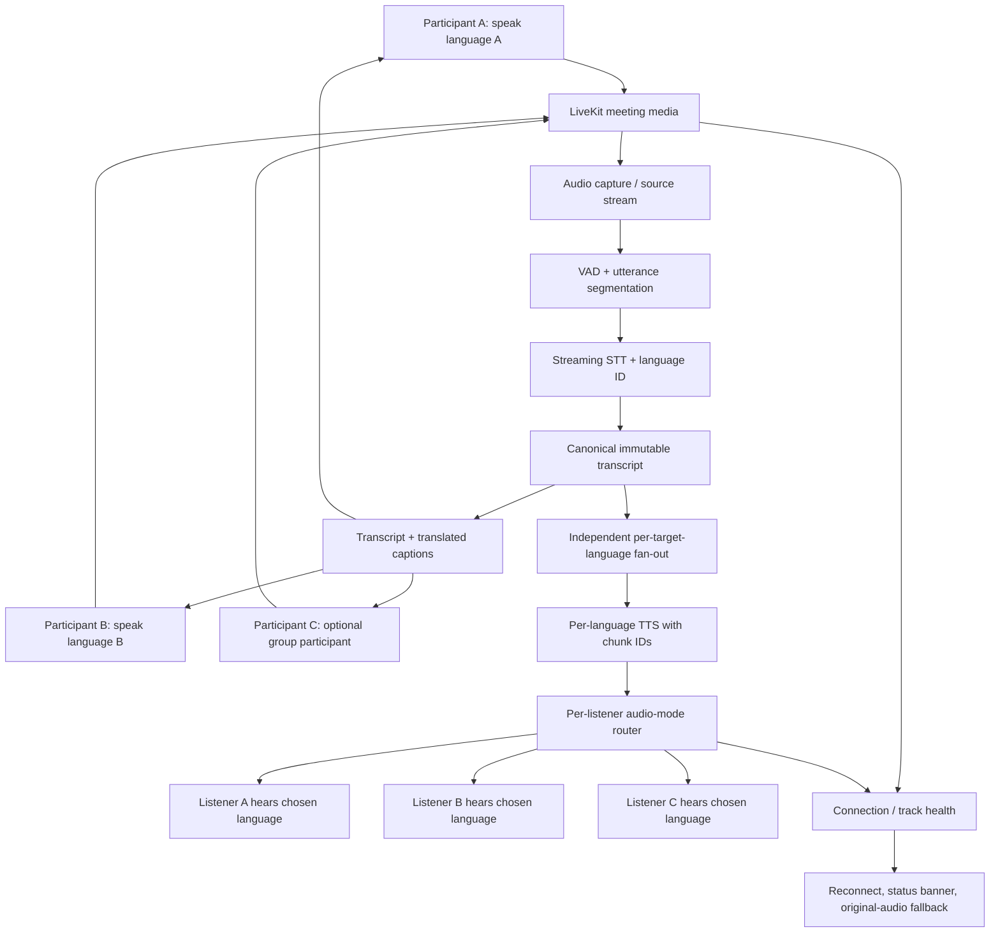

# TalkFlow Live Meeting Translation Skill

## Goal
Make existing TalkFlow human-to-human and group meetings reliable, like a video-conferencing product, while each participant can speak their language and hear their chosen target language. Full implementation scope is tracked in [GitHub Issue #53](https://github.com/Aman678317/TalkFlow/issues/53).

## Guardrails
- Extend the existing architecture; do not replace the UI, authentication, meeting flow, or database wholesale.
- Inspect the canonical backend under `services/api`; do not accidentally start the legacy `apps/api` as a second service.
- Keep video connectivity and AI translation as separate failure domains: translation failure must not end the call.
- Do not claim production-ready or fully working without real browser/device tests and observed test results.
- Never expose meeting tokens or provider secrets in logs, URLs beyond intended short-lived join tickets, or frontend bundles.

## Existing code to inspect
- `apps/web/src/pages/MeetingRoom.tsx`
- `apps/web/src/hooks/useLiveKitRoom.ts`
- `apps/web/src/lib/webrtc.ts`
- `apps/web/src/lib/ws.ts`
- `apps/web/src/lib/audio.ts`
- `services/api/app/routers/meetings.py`
- `services/api/app/services/meeting_service.py`
- `services/api/app/realtime/pipeline.py`
- `tests/realtime/test_golden_call.py`
- `docs/REALTIME.md`
- `docs/REALTIME_PRODUCTION.md`

## Target architecture
1. Browser or phone microphone capture with permission/device status.
2. Canonical media transport: LiveKit SFU for production group audio/video; WebSocket PCM only where intentionally configured as a fallback/dev transport.
3. VAD and streaming STT with language identification.
4. Immutable canonical transcript segment with speaker ID, utterance ID, sequence number, and timestamps.
5. Independent translation fan-out from the canonical source to each unique listener language.
6. One TTS stream per target language, correctly framed/chunk-indexed and deduplicated.
7. Per-listener router that delivers the selected original/translated mode and captions without leaking one listener's audio mode into another's.
8. Call-health UI, latency telemetry, reconnect and cleanup paths.

Never translate from a prior translation. Never feed generated TTS back into STT. Original audio must remain available if AI stages fail.

## Implementation phases

### Phase 0 — baseline and map the call paths
- Trace room creation, participant join, transport selection, microphone capture, binary audio framing, translation events, TTS chunk delivery/playback, audio unlock, camera tracks and leave cleanup.
- Establish a reproducible two-browser test and collect logs for both peers.
- Confirm which transport is active at runtime. Avoid silently mixing LiveKit audio and WebSocket translated playback.
- Record current build/test results before editing.

### Phase 1 — make the human call stable
- Verify local/remote camera and microphone tracks, permissions, mute/camera toggles, join/leave, reconnect and peer cleanup.
- Use LiveKit as the canonical group media transport where configured; use P2P only for an explicitly supported fallback path.
- Test audio autoplay/unlock and mobile browser behavior.
- Keep original call audio working even if translation sockets disconnect.
- Configure and test TURN in the target deployment; STUN-only connectivity is not a production guarantee.

### Phase 2 — prove live translated audio end-to-end
- Validate input format is PCM16 mono 16 kHz where the existing pipeline expects it.
- Follow one utterance ID from capture through STT, canonical segment, translation, TTS, transport frame and actual audio playback.
- Ensure every TTS chunk carries stable segment identity, target language and monotonic chunk index; do not deduplicate separate chunks as if they were duplicate whole utterances.
- Test both Hindi→English and English→Hindi with two actual browser sessions, and verify the listener hears the translated voice rather than only seeing a translated caption.
- Preserve partial captions, final captions and translation association using utterance/segment IDs rather than display-name timing.
- Route translated audio only to listeners whose selected language/audio mode matches.

### Phase 3 — group calls and resilience
- Test 3+ participants, including two listeners sharing one target language and another listener using a different target language.
- Changing one participant's listening language must not change another's route.
- Add bounded queues and backpressure; drop stale chunks rather than growing delay indefinitely.
- Test network loss, socket half-open, reconnect/resume, mic unplug, permission denial, mute/unmute, camera off, speaker join/leave and page refresh.
- On STT/MT/TTS failure, keep the human meeting alive and show a visible translation-degraded state with original audio/captions fallback.

### Phase 4 — tests and production readiness
- Unit tests: frame parser, chunk ordering, dedupe identity, listener routing, utterance association, cleanup and state transitions.
- Integration tests: audio capture → STT → translation → TTS → websocket/LiveKit delivery → player queue.
- Browser E2E: two browsers, then 3+ participants, real camera/mic, both language directions, target-language isolation and reconnect.
- Verify mobile browser audio unlock and device changes.
- Measure actual p50/p95/p99 latency by language pair and transport; do not promise sub-second latency without evidence.
- Confirm TLS/WSS, scoped room tokens, TURN/SFU settings, health metrics, alerts and secrets handling.

## Mermaid flow graph

## Required completion report
When implementing, report changed files and commit/PR links, exact tests run and results, deployment requirements, known limitations, and whether a real multi-browser audio/video call was exercised. Do not describe issue/skill documentation as an application-code fix.
