# Database

PostgreSQL in production (pgvector enabled), SQLite in dev — identical SQLAlchemy models,
Alembic migration `d6049c5192e5_initial_schema` (39 tables) is the schema source of truth.
UUID (CHAR(36)) primary keys, `created_at/updated_at` everywhere, FK cascades, deliberate
indexes (tenant+time, meeting+sequence, lookup hashes).

## ER overview (mermaid)

```mermaid
erDiagram
  users ||--o{ organization_members : ""
  organizations ||--o{ organization_members : ""
  organizations ||--o{ projects : ""
  users ||--o{ sessions : ""
  users ||--o{ refresh_tokens : ""
  sessions ||--o{ refresh_tokens : ""
  organizations ||--o{ api_keys : ""
  organizations ||--o{ meetings : ""
  organizations ||--o{ subscriptions : ""
  organizations ||--o{ billing_events : ""
  organizations ||--o{ usage_records : ""
  organizations ||--o{ glossaries : ""
  glossaries ||--o{ glossary_terms : ""
  organizations ||--o{ translation_memories : ""
  organizations ||--o{ style_profiles : ""
  organizations ||--o{ documents : ""
  documents ||--o{ document_jobs : ""
  documents ||--o{ document_segments : ""
  meetings ||--o{ participants : ""
  participants ||--|| participant_preferences : ""
  meetings ||--o{ audio_sessions : ""
  meetings ||--o{ transcript_segments : ""
  meetings ||--o{ chat_messages : ""
  transcript_segments ||--o{ translation_segments : "source_segment_id"
  chat_messages ||--o{ translation_segments : "source_segment_id"
  organizations ||--o{ webhooks : ""
  webhooks ||--o{ webhook_deliveries : ""
  organizations ||--o{ memory_items : ""
  organizations ||--o{ agent_sessions : ""
  organizations ||--o{ audit_logs : ""
  users ||--o{ voice_consents : ""
```



## Table groups

**Identity & tenancy** — users, organizations, organization_members, projects, sessions,
refresh_tokens, api_keys. Passwords bcrypt(12); refresh tokens and API keys stored as
SHA-256 hashes only.

**Language & model truth** — language_capabilities (per-language, per-modality, validated
statuses EXPERIMENTAL/BETA/SUPPORTED/PRODUCTION + provider bindings),
language_pair_validations (each pair direction/task independently evaluated),
model_registry (task, provider, model_id, pinned revision, license + review status,
production_status, hardware, latency/quality).

**Meetings & realtime** — meetings (room_name + join_token), participants,
participant_preferences ("I speak / I hear / audio_mode / caption_mode / latency_mode" —
the routing truth), audio_sessions (transport, dropouts, reconnects), transcript_segments
(**canonical source**; immutable finals; sequence per meeting; audio_key under retention),
translation_segments (**derivatives**; UNIQUE(source_segment_id, target_language) —
the dedup guarantee at storage level), chat_messages (original immutable) +
voice_consents (AI voice safety: granted/revoked/audit + synthetic flag).

**Documents** — documents (checksum, mime sniffed, versions_used: parser/model/glossary/
style versions + QA result), document_jobs (stage machine + audit log), document_segments
(canonical representation blocks with reconstruction paths).

**Knowledge** — glossaries (+terms with spoken_variants, DNT), style_profiles (versioned,
system vs tenant), translation_memories (source_norm_hash exact index + embedding JSON →
pgvector in prod, usage_count, approved, version).

**Platform** — usage_records (immutable metering events; billing computes from these),
subscriptions/billing_events, audit_logs (actor, action, resource, IP, request_id),
integrations (secret_ref never plaintext), webhooks/webhook_deliveries (attempts,
next_attempt_at), feature_flags (global + per-org), agent_sessions, memory_items (7 memory
classes, scope + embedding + expiry), feedback, quality_evaluations (metric snapshots per
task/pair/provider; gates promotion).

## Migrations

```bash
cd apps/api && alembic upgrade head        # prod path (DB_AUTOCREATE=false)
alembic revision --autogenerate -m "…"     # new migrations
```

Dev convenience: `DB_AUTOCREATE=true` runs `create_all` at startup (never in prod).

## pgvector (production)

`CREATE EXTENSION vector;` then replace JSON `embedding` columns on
translation_memories / memory_items with `vector(256)` + HNSW indexes
(`services/memory/vector_store` adapter isolates this). Tenant-scoped WHERE org_id is
mandatory on every vector query — cross-tenant retrieval is structurally impossible.

## Retention

Three layers, narrowest wins: the deployment's `RETENTION_*_DAYS` defaults, an
organization's `organizations.retention_json`, one room's `meetings.retention_json`.
Defaults are audio 7 d, transcripts 365 d, documents 90 d, usage 730 d; a `null`
value in a policy means that kind of data is not on a clock.

`app.services.retention_service.sweep()` is the only thing that deletes. It runs
hourly from the API's background loop (`app.main._retention_loop`) and from
`workers/cleanup-worker`, once per bucket of rooms that resolve to the same windows:

* **audio** — objects behind `transcript_segments.audio_object_key` and
  `audio_sessions.audio_object_key` are deleted and the column set to NULL. The
  caption row stays, because its window is the longer one on purpose. The realtime
  write path reads the same resolved number before storing a turn's WAV, so a room
  with `audio_days: 0` never writes one.
* **transcripts** — rows past the room's `transcript_days` go, and so do the
  `translation_segments` made from them. Derived rows are deleted by `segment_id`
  explicitly rather than trusted to `ondelete=CASCADE`: SQLite in tests enforces no
  foreign keys at all.
* **documents** — rows with `expires_at` in the past lose both objects and are
  marked `deleted`.
* **usage / sessions / refresh tokens / memory items** — purged on their own clocks.

The `counts` dict (`audio_objects`, `transcripts`, `translations`, `documents`,
`usage`, `expired_tokens`) is logged every pass; it is the only evidence an operator
gets that a policy ran rather than merely was configured. An object that refuses to
delete is logged and its pointer left in place.

The same resolved numbers are what the room tells its participants:
`GET /api/v1/meetings/{id}` returns them under `retention`, and the lobby shows them
before anyone speaks — a guest joining by link sees them too, and that is the person
whose voice is being kept.

Tests: `tests/integration/test_retention_sweep.py`,
`tests/integration/test_meeting_retention_disclosure.py`,
`tests/unit/test_realtime_audio_retention.py`.
