# Database

PostgreSQL in production (pgvector enabled), SQLite in dev.

**There are two schema models in this repository, and they are not the same.** They
are reconciled by separate Alembic lineages with separate version rows:

| Lineage | Owned by | Migrations | Tables | Version table | Deployed? |
|---|---|---|---|---|---|
| API | `services/api` (`app/db/models.py`, async SQLAlchemy) | `services/api/alembic` — `eae02319e4b2_initial_schema` → `2202ca7dc080_harmonize_schema_models` | 43 | `alembic_version` | yes — every entrypoint (`render-build.sh`, `start.sh`, `Dockerfile.api` WORKDIR, k8s migration Job, docker-compose) runs `alembic upgrade head` here |
| Legacy worker | `apps/api` (`globaltalk/models.py`, sync SQLAlchemy) | `apps/api/alembic` — `d6049c5192e5` → `e7150a82b3d1` → `4889ad87949b_complete_webhook_and_language_columns` | 39 | `alembic_version_globaltalk` | only `globaltalk.workers.run` (k8s `inference-gpu`), never the HTTP API |

The API lineage is the schema source of truth for the product. The table descriptions
below follow `services/api`. UUID primary keys, `created_at/updated_at` everywhere, FK
cascades, deliberate indexes (tenant+time, meeting+sequence, lookup hashes).

The two model sets still diverge — 35 tables are shared but with different column names
and id types (`sa.Uuid` vs `GUID(36)`), and each side has tables the other lacks
(API: `phone_numbers`, `call_sessions`, `call_events`, `agent_prompts`, `prompt_versions`,
`language_pair_capabilities`, `translation_memory_entries`, `webhook_endpoints`;
legacy: `webhooks`, `voice_consents`, `translation_history`, `language_pair_validations`).
Merging them into one model file is a deliberate, separate piece of work; what Phase 7
fixed is the part that could silently corrupt a live database (see Migrations).

## ER overview (mermaid)

```mermaid
erDiagram
  users ||--o{ organization_members : ""
  organizations ||--o{ organization_members : ""
  organizations ||--o{ projects : ""
  users ||--o{ sessions : ""
  users ||--o{ refresh_tokens : ""
  sessions ||--o{ refresh_tokens : ""
  organizations ||--o{ api_keys : ""
  organizations ||--o{ meetings : ""
  organizations ||--o{ subscriptions : ""
  organizations ||--o{ billing_events : ""
  organizations ||--o{ usage_records : ""
  organizations ||--o{ glossaries : ""
  glossaries ||--o{ glossary_terms : ""
  organizations ||--o{ translation_memories : ""
  organizations ||--o{ style_profiles : ""
  organizations ||--o{ documents : ""
  documents ||--o{ document_jobs : ""
  documents ||--o{ document_segments : ""
  meetings ||--o{ participants : ""
  participants ||--|| participant_preferences : ""
  meetings ||--o{ audio_sessions : ""
  meetings ||--o{ transcript_segments : ""
  meetings ||--o{ chat_messages : ""
  transcript_segments ||--o{ translation_segments : "source_segment_id"
  chat_messages ||--o{ translation_segments : "source_segment_id"
  organizations ||--o{ webhooks : ""
  webhooks ||--o{ webhook_deliveries : ""
  organizations ||--o{ memory_items : ""
  organizations ||--o{ agent_sessions : ""
  organizations ||--o{ audit_logs : ""
  users ||--o{ voice_consents : ""
```



## Table groups

**Identity & tenancy** — users, organizations, organization_members, projects, sessions,
refresh_tokens, api_keys. Passwords bcrypt(12); refresh tokens and API keys stored as
SHA-256 hashes only.

**Language & model truth** — language_capabilities (per-language, per-modality, validated
statuses EXPERIMENTAL/BETA/SUPPORTED/PRODUCTION + provider bindings),
language_pair_validations (each pair direction/task independently evaluated),
model_registry (task, provider, model_id, pinned revision, license + review status,
production_status, hardware, latency/quality).

**Meetings & realtime** — meetings (room_name), participants (server-issued seat identity),
participant_preferences ("I speak / I hear / audio_mode / caption_mode / latency_mode" —
the routing truth), audio_sessions (transport, dropouts, reconnects), transcript_segments
(**canonical source**; immutable finals; sequence per meeting; audio_key under retention),
translation_segments (**derivatives**; UNIQUE(source_segment_id, target_language) —
the dedup guarantee at storage level), chat_messages (original immutable) +
voice_consents (AI voice safety: granted/revoked/audit + synthetic flag).

**Documents** — documents (checksum, mime sniffed, versions_used: parser/model/glossary/
style versions + QA result), document_jobs (stage machine + audit log), document_segments
(canonical representation blocks with reconstruction paths).

**Knowledge** — glossaries (+terms with spoken_variants, DNT), style_profiles (versioned,
system vs tenant), translation_memories (source_norm_hash exact index + embedding JSON →
pgvector in prod, usage_count, approved, version).

**Platform** — usage_records (immutable metering events; billing computes from these),
subscriptions/billing_events, audit_logs (actor, action, resource, IP, request_id),
integrations (secret_ref never plaintext), webhooks/webhook_deliveries (attempts,
next_attempt_at), feature_flags (global + per-org), agent_sessions, memory_items (7 memory
classes, scope + embedding + expiry), feedback, quality_evaluations (metric snapshots per
task/pair/provider; gates promotion).

## Migrations

```bash
# The API lineage — this is what deployment runs.
cd services/api && alembic upgrade head
cd services/api && alembic check                       # model vs schema, must be empty
cd services/api && alembic revision --autogenerate -m "…"

# The legacy worker lineage — its own database, never the API's.
cd apps/api && alembic upgrade head
```

Both lineages must be applied to a database before that process boots in production:

- `services/api` `_ensure_schema()` (`app/main.py`) reads `alembic_version` and compares it
  to the head **resolved from `services/api/alembic/versions`**, not a literal, so adding a
  revision tightens the gate instead of stranding the deployment. Unknown, missing or
  rolled-back revisions all fail closed.
- `apps/api` `init_db()` (`globaltalk/core/db.py`) does the same against
  `alembic_version_globaltalk`.

Dev convenience: `DB_AUTOCREATE=true` (the default outside production) runs
`Base.metadata.create_all` at startup. It never runs in production, regardless of the
flag, and `apps/api` no longer patches columns with raw `ALTER TABLE` at boot — the
columns that patcher invented are migration `4889ad87949b`, so a database migrated to
head matches the models its workers use.

Because deployment gives both processes the same `DATABASE_URL`, the legacy lineage keeps
its own version table. Before that, `cd apps/api && alembic upgrade head` (which
`docs/DATABASE.md` used to recommend as "the prod path") would overwrite the API's
`alembic_version` row with a revision the API cannot resolve and every production API
replica would refuse to start. Applying the legacy lineage to the API database is still
wrong — it now fails loudly on the first `CREATE TABLE` instead of corrupting the gate.
If you have a dev SQLite database that was migrated by `apps/api` before this split, run
`cd apps/api && alembic stamp head` once to record its revision in the new table.

## pgvector (production)

`CREATE EXTENSION vector;` then replace JSON `embedding` columns on
translation_memories / memory_items with `vector(256)` + HNSW indexes
(`services/memory/vector_store` adapter isolates this). Tenant-scoped WHERE org_id is
mandatory on every vector query — cross-tenant retrieval is structurally impossible.

## Retention

Per-org policy (`organizations.retention_policy`, defaults from env): audio (7 d),
transcripts (90 d), documents (90 d). `workers/cleanup.py` deletes objects + rows,
revoked voice-consent samples destroyed on sweep. Every deletion auditable via job logs.
