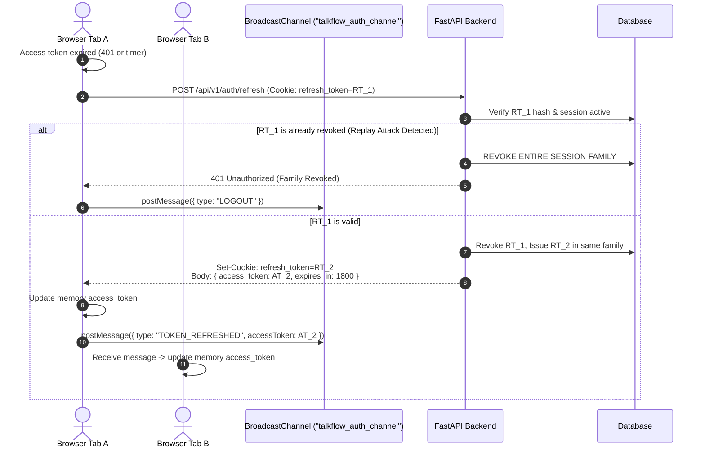

# TalkFlow / GlobalTalk AI — Production Authentication Hardening Specification

**Status**: Enforced in code — each claim below names the mechanism and the test that pins it. One area is **not** yet done: real (non-mock) social login (see §4).
**Standard**: OWASP ASVS v4.0, Zero-Trust Browser Security, RFC 6749 / RFC 7519

> Scope note: this document covers the **deployed** backend `services/api` and the
> `apps/web` SPA. It does not describe the legacy `apps/api` tree.

---

## 1. Overview & Threat Model

The original SPA authentication model stored both `access_token` and `refresh_token` in browser `localStorage`. Under an XSS attack or third-party script compromise, those tokens could be exfiltrated immediately, enabling persistent account takeover. Additionally, legacy development shortcuts allowed unverified logins, automatic account creation with arbitrary passwords, and client-supplied identities during social login.

The hardened architecture enforces:
1. **Memory-Only Access Tokens**: Kept strictly within browser runtime memory (a JavaScript module variable in `apps/web/src/lib/api.ts`). Never persisted to `localStorage`, `sessionStorage`, or IndexedDB. A refresh token in the login body is explicitly ignored.
   *Enforced by:* `setTokens(access)` takes only the access token; no `gt.access`/`gt.refresh` write path exists. *Test:* `apps/web/src/stores/auth.test.ts` asserts `localStorage.getItem("gt.access"/"gt.refresh")` is null after login and that an in-body `refresh_token` is never stored.
2. **HttpOnly, Secure, SameSite Refresh Cookies**: The refresh token is delivered **only** as an `HttpOnly` cookie path-scoped to `/api/v1/auth`; the JSON body's `refresh_token` is blanked on signup, login, social-login, and refresh. `Secure` is set when `secure_cookies` or `app_env=production`.
   *Test:* `tests/test_auth_hardened.py::test_signup_sets_httponly_cookie` (cookie present, `HttpOnly`, body copy == `""`) and `test_silent_refresh_via_cookie_only` (empty-body, cookie-only refresh rotates).
3. **Cryptographic Refresh Token Rotation**: Every refresh exchange rotates the refresh token; the previous token is revoked immediately (15s concurrent-tab grace window). *Test:* `test_refresh_token_rotation_and_cookie`.
4. **Token Family Replay Detection**: Replaying an already-revoked refresh token revokes the entire session family. *Test:* `test_refresh_token_reuse_detection`, `test_logout_all_revokes_sessions`, `test_password_change_invalidates_sessions`.
5. **Development shortcuts fail closed in ALL modes** — gated behind explicit opt-in flags, not on absence of production:
   - `ALLOW_TEST_AUTH` (default **false**): when off, wildcard keys (`test-key-…` / `…:fx`) and mock/unsigned social tokens are rejected, in dev, test, and prod alike.
   - `ALLOW_SEED` (default **false**): when off, startup never creates the demo / platform-admin users. Registry, languages, flags and style data still seed unconditionally — only the *credential* backdoor is gated.
   *Test:* `tests/test_auth_hardened.py::test_wildcard_test_key_rejected_when_opt_in_off`, `test_mock_social_token_rejected_when_opt_in_off`, `test_demo_user_not_seeded_when_opt_in_off`.
6. **Social identity verification**: with `ALLOW_TEST_AUTH` off (the default everywhere including production), mock tokens are refused and only provider-verified credentials are accepted — **but real provider verification is not yet wired (see §4)**.


---

## 2. Authentication Lifecycle

### 2.1 Registration & Login Flow

```mermaid
sequenceDiagram
    autonumber
    actor User as Browser (SPA)
    participant API as FastAPI Backend
    participant DB as Database (PostgreSQL/SQLite)

    User->>API: POST /api/v1/auth/login { email, password }
    API->>DB: Query User by normalized email
    alt User not found or password invalid
        API-->>User: 401 Unauthorized (constant-time response)
    else Credentials valid
        API->>DB: Create UserSession & RefreshToken record
        API->>DB: Record audit log (auth.login)
        API-->>User: Set-Cookie: refresh_token=...; HttpOnly; Secure; SameSite=Lax<br/>Body: { tokens: { access_token, expires_in }, user, membership }
        User->>User: Store access_token in memory only
    end
```

### 2.2 Silent Refresh & Multi-Tab Synchronization Flow



---

## 3. Session Revocation & Logout

1. **Individual Logout (`POST /api/v1/auth/logout`)**:
   - Clears `refresh_token` cookie via `Max-Age=0`.
   - Revokes current `RefreshToken` row in database.
   - Clears in-memory access token.
   - Posts `LOGOUT` across `BroadcastChannel` to synchronize all open tabs.
2. **Password Change / Reset**:
   - Password reset immediately marks all active refresh tokens for the user as `revoked = True`.
   - All browser sessions on all devices are terminated.
   - Generates security audit event `auth.password_reset_completed`.

---

## 4. Social Authentication Hardening

**Status of this section: PARTIALLY DONE — real provider verification is Phase 2 and is NOT yet implemented.**

What is true today:
- With `ALLOW_TEST_AUTH` off (the default in every mode), `social_auth_service._check_test_token` returns `None`, so mock/unsigned `mock-google:…` tokens are refused. `tests/test_social_auth_hardened.py` exercises the mock path only because it opts in to that flag locally; `test_social_login_rejects_forged_or_invalid_jwt` proves forged JWTs are rejected with the flag off.
- Client-supplied body email/name cannot override a verified provider claim, and unverified provider emails cannot link to an existing password account. *Tests:* `test_social_login_provisions_new_user_and_identity`, `test_account_takeover_prevented_on_unverified_email`.

What is **not** true yet (open work, deliberately out of scope for this phase):
- The backend does **not** validate a real Google `id_token` against Google's JWKS, nor exchange a GitHub/Apple code. `services/api/app/config.py` does not define `google_client_id` / `github_client_id` / `apple_client_id`, so a genuine (non-mock) social login currently raises rather than succeeding. Real provider verification is **Phase 2**.

Do not ship public social sign-in relying on this section until Phase 2 lands.


---

## 5. Security Controls & Header Configuration

The backend middleware (`services/api/app/middleware.py`) injects enterprise-grade defensive security headers on all responses:

| Header | Production Setting | Rationale |
|---|---|---|
| `Strict-Transport-Security` | `max-age=63072000; includeSubDomains; preload` | Forces HTTPS and prevents SSL stripping. |
| `X-Content-Type-Options` | `nosniff` | Prevents MIME-type confusion attacks. |
| `X-Frame-Options` | `DENY` | Eliminates clickjacking attacks. |
| `Referrer-Policy` | `strict-origin-when-cross-origin` | Minimizes URL leakage in external requests. |
| `Permissions-Policy` | `geolocation=(), camera=(self), microphone=(self)` | Restricts browser hardware access strictly to authenticated origin. |
| `Content-Security-Policy` | Configured with restrictive default-src, connect-src, and script-src | Mitigates XSS injection risks. |

---

## 6. Verification & Automated Test Evidence

Automated test suites verifying the hardened authentication design:
- `tests/test_auth_hardened.py`:
  - `test_signup_sets_httponly_cookie` — cookie set + `HttpOnly`, body `refresh_token` blanked (PASS)
  - `test_login_sets_cookie_and_rejects_bad_credentials` (PASS)
  - `test_silent_refresh_via_cookie_only` — empty-body, cookie-only refresh rotates (PASS)
  - `test_refresh_token_rotation_and_cookie` (PASS)
  - `test_refresh_token_reuse_detection` (PASS)
  - `test_logout_clears_cookie` / `test_logout_all_revokes_sessions` / `test_password_change_invalidates_sessions` (PASS)
  - `test_csrf_cookie_issued_on_auth` (PASS)
  - `test_wildcard_test_key_rejected_when_opt_in_off` / `test_mock_social_token_rejected_when_opt_in_off` / `test_demo_user_not_seeded_when_opt_in_off` — backdoors fail closed with the flags at their default (PASS)
- `apps/web/src/stores/auth.test.ts`:
  - Access token held in memory only; a body `refresh_token` is ignored; no `gt.access`/`gt.refresh` ever written (PASS)
  - Silent cookie bootstrap authenticates via refresh → `/me`; skipped after an explicit logout (PASS)
  - Clean state reset on logout (PASS)
- `tests/browser_e2e/runner.py`: the browser journey signs up through the real `/signup` form (`ALLOW_SEED=false`, `ALLOW_TEST_AUTH=false`) — no demo account or test-only credential path.
- CI: the backend and browser-e2e lanes must stay green with both opt-in flags off.
