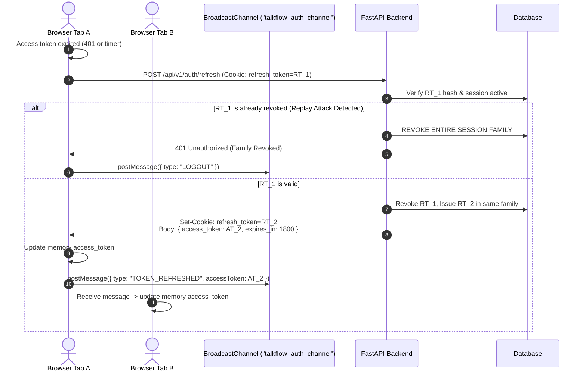

# TalkFlow / GlobalTalk AI — Production Authentication Hardening Specification

**Status**: Enforced in code — each claim below names the mechanism and the test that pins it. Real (non-mock) social login is implemented and **fails closed** when a provider is unconfigured (§4); operators must supply OAuth client IDs to enable it.
**Standard**: OWASP ASVS v4.0, Zero-Trust Browser Security, RFC 6749 / RFC 7519

> Scope note: this document covers the **deployed** backend `services/api` and the
> `apps/web` SPA. It does not describe the legacy `apps/api` tree.

---

## 1. Overview & Threat Model

The original SPA authentication model stored both `access_token` and `refresh_token` in browser `localStorage`. Under an XSS attack or third-party script compromise, those tokens could be exfiltrated immediately, enabling persistent account takeover. Additionally, legacy development shortcuts allowed unverified logins, automatic account creation with arbitrary passwords, and client-supplied identities during social login.

The hardened architecture enforces:
1. **Memory-Only Access Tokens**: Kept strictly within browser runtime memory (a JavaScript module variable in `apps/web/src/lib/api.ts`). Never persisted to `localStorage`, `sessionStorage`, or IndexedDB. A refresh token in the login body is explicitly ignored.
   *Enforced by:* `setTokens(access)` takes only the access token; no `gt.access`/`gt.refresh` write path exists. *Test:* `apps/web/src/stores/auth.test.ts` asserts `localStorage.getItem("gt.access"/"gt.refresh")` is null after login and that an in-body `refresh_token` is never stored.
2. **HttpOnly, Secure, SameSite Refresh Cookies**: The refresh token is delivered **only** as an `HttpOnly` cookie path-scoped to `/api/v1/auth`; the JSON body's `refresh_token` is blanked on signup, login, social-login, and refresh. `Secure` is set when `secure_cookies` or `app_env=production`.
   *Test:* `tests/test_auth_hardened.py::test_signup_sets_httponly_cookie` (cookie present, `HttpOnly`, body copy == `""`) and `test_silent_refresh_via_cookie_only` (empty-body, cookie-only refresh rotates).
3. **Cryptographic Refresh Token Rotation**: Every refresh exchange rotates the refresh token; the previous token is revoked immediately (15s concurrent-tab grace window). *Test:* `test_refresh_token_rotation_and_cookie`.
4. **Token Family Replay Detection**: Replaying an already-revoked refresh token revokes the entire session family. *Test:* `test_refresh_token_reuse_detection`, `test_logout_all_revokes_sessions`, `test_password_change_invalidates_sessions`.
5. **Development shortcuts fail closed in ALL modes** — gated behind explicit opt-in flags, not on absence of production:
   - `ALLOW_TEST_AUTH` (default **false**): when off, wildcard keys (`test-key-…` / `…:fx`) and mock/unsigned social tokens are rejected, in dev, test, and prod alike.
   - `ALLOW_SEED` (default **false**): when off, startup never creates the demo / platform-admin users. Registry, languages, flags and style data still seed unconditionally — only the *credential* backdoor is gated.
   *Test:* `tests/test_auth_hardened.py::test_wildcard_test_key_rejected_when_opt_in_off`, `test_mock_social_token_rejected_when_opt_in_off`, `test_demo_user_not_seeded_when_opt_in_off`.
6. **Social identity verification (Phase 2)**: identity comes **only** from provider-verified credentials — Google/Apple ID tokens verified against provider JWKS (RS256, `aud` == the configured client ID, `iss`, `exp`), GitHub authorization codes exchanged server-side and the authenticated user's verified email fetched. Arbitrary client-supplied emails/profiles are rejected with 422. Unconfigured providers fail closed with 401 ("not configured on this server") — never a fabricated identity. Apple requires matching client/server nonces.
   *Test:* `tests/test_social_real_verification.py` (9 tests) — deterministic mapping of a verified identity to the same user on repeat login, wrong `aud`/`iss`/expired → 401, unconfigured Google → 401, Apple nonce mismatch → 401 / match → 200, profile-only payload → 422, GitHub with no server-side client config → 401. With `ALLOW_TEST_AUTH` off (default), mock tokens are refused in every mode.


---

## 2. Authentication Lifecycle

### 2.1 Registration & Login Flow

```mermaid
sequenceDiagram
    autonumber
    actor User as Browser (SPA)
    participant API as FastAPI Backend
    participant DB as Database (PostgreSQL/SQLite)

    User->>API: POST /api/v1/auth/login { email, password }
    API->>DB: Query User by normalized email
    alt User not found or password invalid
        API-->>User: 401 Unauthorized (constant-time response)
    else Credentials valid
        API->>DB: Create UserSession & RefreshToken record
        API->>DB: Record audit log (auth.login)
        API-->>User: Set-Cookie: refresh_token=...; HttpOnly; Secure; SameSite=Lax<br/>Body: { tokens: { access_token, expires_in }, user, membership }
        User->>User: Store access_token in memory only
    end
```

### 2.2 Silent Refresh & Multi-Tab Synchronization Flow



---

## 3. Session Revocation & Logout

1. **Individual Logout (`POST /api/v1/auth/logout`)**:
   - Clears `refresh_token` cookie via `Max-Age=0`.
   - Revokes current `RefreshToken` row in database.
   - Clears in-memory access token.
   - Posts `LOGOUT` across `BroadcastChannel` to synchronize all open tabs.
2. **Password Change / Reset**:
   - Password reset immediately marks all active refresh tokens for the user as `revoked = True`.
   - All browser sessions on all devices are terminated.
   - Generates security audit event `auth.password_reset_completed`.

---

## 4. Social Authentication Hardening

**Status: Implemented (Phase 2) — cryptographic provider verification, fail-closed when unconfigured.**

What is enforced today:
- **Google** (`services/api/app/services/social_auth_service.py::_verify_google`): the ID token's RS256 signature is verified against Google's JWKS, `iss` must be `accounts.google.com` (or its bare-host form), `exp` is enforced, and `aud` must equal `GOOGLE_CLIENT_ID` — **which is required**: an unconfigured provider fails closed with 401 instead of accepting an audience-unvalidated token. An authorization `code` may be exchanged server-side when client id + secret are set. *Tests:* `tests/test_social_real_verification.py` (valid token maps deterministically; wrong `aud`/`iss`/`exp` → 401; unconfigured → 401).
- **GitHub** (`_verify_github`): the authorization `code` is exchanged server-side for an access token (requires `GITHUB_CLIENT_ID`/`GITHUB_CLIENT_SECRET`, else fail-closed 401), then the authenticated user and their **verified** primary email are read from the GitHub API. A client-supplied email is never consulted. *Test:* `test_github_code_exchange_fails_closed_when_unconfigured`.
- **Apple** (`_verify_apple`): identity token verified against Apple's public keys with `aud == APPLE_CLIENT_ID` (required, fail closed) and `iss == appleid.apple.com`; **nonce replay defence** — when the client supplies a nonce it must match the token's `nonce` claim, and a nonce-bound token may not be replayed without it. *Tests:* `test_apple_nonce_mismatch_rejected`, `test_apple_nonce_match_accepted`.
- **No client-asserted identity**: `SocialLoginRequest` carries only `token` / `code` / `redirect_uri` / `nonce` — email, name, avatar, and provider_user_id fields were removed from the API contract. A profile submission without a credential is a 422. *Test:* `test_client_asserted_profile_without_credential_rejected`.
- **Deterministic mapping & takeover protection**: the verified `(provider, provider_user_id)` maps to `UserIdentity` and its linked user; linking to an existing password account happens **only** when the provider asserts `email_verified=true`. *Tests:* `test_social_login_provisions_new_user_and_identity`, `test_account_takeover_prevented_on_unverified_email`, `test_social_login_resolves_existing_identity`.
- **Mock tokens remain an opt-in escape hatch only** (`ALLOW_TEST_AUTH`, default off in every mode) — used by the hardened-suite tests, never by the real-verification suite.

Operator requirements to switch a provider on: create the OAuth app at the provider, set the server-side `GOOGLE_CLIENT_ID`/`SECRET` (etc.) **and** the SPA's public `VITE_*` client id; GitHub's redirect lands on `/auth/callback/github`. Until then the SPA says the provider "is not configured on this deployment" instead of sending a doomed request.


---

## 5. Security Controls & Header Configuration

The backend middleware (`services/api/app/middleware.py`) injects enterprise-grade defensive security headers on all responses:

| Header | Production Setting | Rationale |
|---|---|---|
| `Strict-Transport-Security` | `max-age=63072000; includeSubDomains; preload` | Forces HTTPS and prevents SSL stripping. |
| `X-Content-Type-Options` | `nosniff` | Prevents MIME-type confusion attacks. |
| `X-Frame-Options` | `DENY` | Eliminates clickjacking attacks. |
| `Referrer-Policy` | `strict-origin-when-cross-origin` | Minimizes URL leakage in external requests. |
| `Permissions-Policy` | `geolocation=(), camera=(self), microphone=(self)` | Restricts browser hardware access strictly to authenticated origin. |
| `Content-Security-Policy` | Configured with restrictive default-src, connect-src, and script-src | Mitigates XSS injection risks. |

---

## 6. Verification & Automated Test Evidence

Automated test suites verifying the hardened authentication design:
- `tests/test_auth_hardened.py`:
  - `test_signup_sets_httponly_cookie` — cookie set + `HttpOnly`, body `refresh_token` blanked (PASS)
  - `test_login_sets_cookie_and_rejects_bad_credentials` (PASS)
  - `test_silent_refresh_via_cookie_only` — empty-body, cookie-only refresh rotates (PASS)
  - `test_refresh_token_rotation_and_cookie` (PASS)
  - `test_refresh_token_reuse_detection` (PASS)
  - `test_logout_clears_cookie` / `test_logout_all_revokes_sessions` / `test_password_change_invalidates_sessions` (PASS)
  - `test_csrf_cookie_issued_on_auth` (PASS)
  - `test_wildcard_test_key_rejected_when_opt_in_off` / `test_mock_social_token_rejected_when_opt_in_off` / `test_demo_user_not_seeded_when_opt_in_off` — backdoors fail closed with the flags at their default (PASS)
- `tests/test_social_real_verification.py` (Phase 2 — real RS256/JWKS verification):
  - `test_verified_google_identity_maps_deterministically` — same verified identity → same user id on repeat login (PASS)
  - `test_google_wrong_audience_rejected` / `test_google_wrong_issuer_rejected` / `test_google_expired_token_rejected` (PASS)
  - `test_google_unconfigured_fails_closed` — no `google_client_id` → 401 "not configured" (PASS)
  - `test_apple_nonce_mismatch_rejected` / `test_apple_nonce_match_accepted` (PASS)
  - `test_client_profile_only_rejected` — email/name without a provider credential → 422 (PASS)
  - `test_github_unconfigured_code_rejected` (PASS)
- `apps/web/src/stores/auth.test.ts`:
  - Access token held in memory only; a body `refresh_token` is ignored; no `gt.access`/`gt.refresh` ever written (PASS)
  - Silent cookie bootstrap authenticates via refresh → `/me`; skipped after an explicit logout (PASS)
  - Clean state reset on logout (PASS)
- `tests/browser_e2e/runner.py`: the browser journey signs up through the real `/signup` form (`ALLOW_SEED=false`, `ALLOW_TEST_AUTH=false`) — no demo account or test-only credential path.
- CI: the backend and browser-e2e lanes must stay green with both opt-in flags off.
