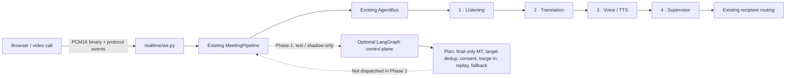

# TalkFlow Realtime LangGraph — Small-Phase Rollout

Status: **Phase 1 prototype**. The graph is deliberately not wired into the live WebSocket or inference hot path yet.

## What already exists

The realtime pipeline already contains four logical agents under `services/api/app/realtime/agents/`:

1. **ListeningAgent** — audio/VAD/STT and canonical final transcript.
2. **TranslationAgent** — contextual MT and distinct-target fan-out.
3. **VoiceAgent** — streaming TTS chunks and provider metadata.
4. **Supervisor** — lifecycle tracking, cancellation, timing and fallback policy.

`pipeline.py` owns the production call path and uses `AgentBus`. `ws.py` owns authenticated WebSocket sessions, PCM16 binary frames, replay and participant lifecycle. Phase 1 does not replace any of these.

## Architecture



The graph carries metadata and decisions only. **Audio bytes must stay on the existing transport**, not inside LangGraph state, checkpoints, prompts or event payloads.

## Phase plan

### Phase 0 — Repository baseline (done)

- Confirm the four realtime agents and existing AgentBus.
- Keep the WebSocket protocol, room/session manager, original-audio relay, auth and database unchanged.
- Preserve the inference providers already selected by TalkFlow.

### Phase 1 — Control-plane planner (this change)

Adds `app/realtime/realtime_graph.py` as an opt-in, deterministic LangGraph planner.

- Partial transcript → wait for a canonical final; never plan MT from unstable text.
- Final transcript → plan one translation for each distinct target language; omit the source language from fan-out.
- Translation ready → request TTS only when the translation is usable.
- TTS chunk ready → authorize metadata-led binary delivery; audio bytes remain outside graph state.
- Barge-in → cancel only the originating speaker's queued audio; reject an unscoped interrupt.
- Language change → refresh target routing.
- Reconnect → return the replay cursor from `last_sequence`.
- Stage failure → emit a recoverable failure action and preserve original audio / captions.
- Consent or policy gate → pause AI processing rather than blocking the original audio path.

This phase returns **planned actions** only. It does not call an STT/MT/TTS provider, send WebSocket messages, mutate a database row, or alter the current live path. Static `interrupt_before` breakpoints are opt-in for operator/debug experiments and must not be enabled for every spoken turn.

### Phase 2 — Shadow observation

- Invoke the planner only for selected control events, never for raw audio frames.
- Record proposed action, route, correlation id and planner duration; do not dispatch its actions.
- Compare decisions against existing AgentBus/Supervisor outcomes.
- Verify no unexpected queue growth or deadline regression.

### Phase 3 — Feature-flagged control dispatch

- Start with finalized transcript and provider-failure events.
- Route only a small allowlist of decisions behind an environment flag.
- On graph exception, timeout or unavailable dependency, fall back to the existing pipeline.
- Keep the current AgentBus as the source of realtime stage events until parity is demonstrated.

### Phase 4 — Human-in-the-loop controls

- Add operator approval for explicit consent / policy exceptions and costly non-urgent operations.
- Use resumable interrupts only on a durable checkpointed control workflow; never put a human pause on ordinary live audio.
- Store approval identity, scope, reason and expiry in the appropriate audit system before resuming.

### Phase 5 — Durable resume and retention

- Use a persistent checkpointer (for example PostgreSQL-backed) only after retention, deletion, tenant isolation and privacy requirements are signed off.
- Keep `thread_id` stable per meeting, bounded in length, and never use an access token or secret as an ID.
- Define checkpoint expiry and deletion behavior before enabling production checkpoint storage.
- `MemorySaver` is for local experiments; its checkpoints are lost when the process exits.

### Phase 6 — Release gate

Do not remove the old routing path until the following all pass:

- Agent contract tests and the existing realtime golden-call tests.
- Reconnect/replay, speaker-scoped cancellation, translation failure, TTS failure and consent-gate tests.
- Load / soak test with measured p50/p95 stage and end-to-end latency compared with the pre-change baseline.
- WebSocket protocol compatibility and mobile/browser call regression tests.
- Security / privacy review for persisted checkpoint content.
- Canary enablement with an immediate feature-flag rollback.

**No live-call latency guarantee is claimed by this prototype.** Establish the baseline and collect actual benchmark output in Phase 2 before deciding whether the graph can participate in dispatch.

## Installation and local test

LangGraph is already declared in `services/api/pyproject.toml` (`langgraph>=0.2`). The lean serverless `services/api/requirements.txt` intentionally omits it, so do not add it to that manifest without repeating deployment-size checks.

PowerShell:

```powershell
cd services/api
python -m pip install -e ".[dev]"
cd ../..
$env:PYTHONPATH = "services/api"
python -m pytest tests/unit/test_realtime_graph.py -q
```

If the project dependencies are already installed and only LangGraph is missing in the local environment:

```powershell
python -m pip install "langgraph>=0.2"
```

The focused workflow installs LangGraph separately and executes the graph integration test. The rest of the current API install path stays unchanged in this phase.

## Current limitations

- No production invocation is connected to `pipeline.py` or `ws.py`.
- The control graph is deterministic: no Groq/OpenAI call and no additional per-utterance LLM reasoning.
- A returned `action` is a proposal for the next dispatcher; it is not proof that translation, cancellation or replay has been executed.
- Human approval is represented as a gate decision in Phase 1. Durable operator interrupts and resume behavior belong to Phase 4.
- Production persistence, retention, and actual latency impact remain unverified until their phases run.

## References

- [LangGraph StateGraph reference](https://reference.langchain.com/python/langgraph/graph/state/StateGraph)
- [LangGraph persistence guide](https://docs.langchain.com/oss/python/langgraph/persistence)
- [LangGraph interrupt guide](https://docs.langchain.com/oss/python/langgraph/interrupts)
