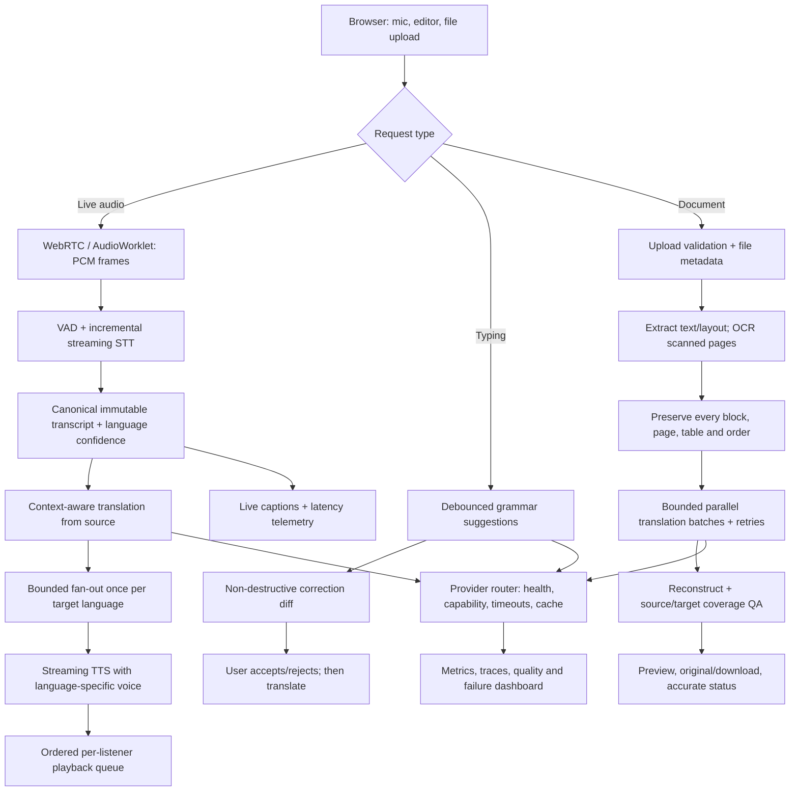

# GlobalTalk AI — Translation Quality & Reliability Remediation Plan

> Goal: make TalkFlow/GlobalTalk AI reliably fast and natural across live speech, text writing/translation, and documents. This plan is based on a review of the current `main` code; it is not a claim that the improvements are already implemented. Extend existing services; do not rebuild the UI, auth, meetings, or database.

## Confirmed findings from the current code

1. **Document throughput bottleneck:** `services/api/app/services/document_service.py::_run_pipeline` awaits `translate_text` once per block in a sequential loop. The code builds a `recent` list but the shown `TranslateContext` call does not pass it as context. Many blocks mean many serial model/network round trips.
2. **PDF extraction/coverage gap:** `parse_pdf` uses PyMuPDF `get_text("blocks")`, or `pypdf.extract_text()` as fallback. There is no OCR path in this parser, so image-only/scanned pages can produce no translatable text. The final quality gate only rejects if over 20% of segments are empty; it does not verify output page/block/character coverage.
3. **PDF fidelity risks:** the current reconstruction redacts/overwrites extracted text in place; the fallback returns an HTML reading copy. Layout overflow, missing blocks, RTL, columns, and whether the output MIME/extension matches the actual result need explicit QA.
4. **Writing quality limitation:** `services/api/app/services/write_service.py::improve_text` is dominated by hand-written regex substitutions and formatting rules. These are useful as a quick-fix fallback, but do not provide robust, context-aware grammar, style, and meaning preservation on their own.
5. **Realtime production readiness must be measured:** the repository defines a VAD → STT → canonical transcript → direct translation fan-out → TTS pipeline, provider routing, and per-stage telemetry. Correct deployed provider configuration, model weights, credentials, voice-language mappings, WebSocket/TURN setup, and CPU/GPU capacity still need a production check. A UI badge or a local test alone does not prove end-to-end translation works.
6. **Use a realistic latency target:** `docs/REALTIME.md` documents a 1.5–2.5 s target for short completed utterances and 8–12 s in a 1 GB CPU sandbox. Use p50/p95/p99 measurements per language pair rather than promising sub-second performance everywhere.

## One architecture graph

## P0 — Make status and failures truthful

- Run and record the current tests/builds before changing behavior.
- Add a server-side readiness/status report for configured provider/model, successful health check, supported language pairs, loaded model/voice, and OCR capability. Never expose keys or secrets.
- Propagate request/trace IDs from browser/WebSocket through STT, translation, TTS and document jobs.
- Record per-stage elapsed time, chosen provider/model, retries, queue depth, dropped frames, detected language/confidence, document pages/characters/blocks extracted and translated, and output MIME.
- UI status must clearly distinguish `ready`, `degraded`, and `unavailable`. Do not show “translation active” if only source captions or a development placeholder is working.

## P1 — Real-time audio and translation

1. Validate the audio contract on both ends: PCM16 mono, 16 kHz, expected frame sizes and order. Add sequence numbers; reject malformed/out-of-order frames. Keep the original human audio route independent of AI.
2. Use partial STT for captions, but translate/synthesize only stable phrases or finalized segments; stale partials must be cancelled so corrections never produce competing audio. Tune pause/clause boundaries from measured latency.
3. Warm the active STT/MT/TTS models per worker; avoid model loading per request. Check for blocking inference inside the async event loop; move blocking CPU/GPU work to a thread/process worker. Use deadlines and bounded semaphores per provider.
4. Respect explicitly selected speech language; otherwise combine STT language/confidence with a fallback prompt when uncertain. Apply glossary, prior source context, names/numbers/date/code protection and domain vocabulary.
5. Translate each target directly from the canonical source — never chain through another translated language. Run target languages concurrently; one failed target must not block others.
6. Stream numbered TTS chunks early, using language-appropriate voices. Ensure per-language playback queues preserve order, suppress duplicate chunks, cancel on barge-in, and do not allow synthetic audio to re-enter STT.
7. Implement clear timeouts, transient-only retries, bounded queues, reconnect backoff, event-loop lag monitoring, and honest captions-only fallback.
8. Verify HTTPS/WSS and WebRTC/TURN from Android/mobile data and restrictive NATs. TURN fixes connectivity, not translation accuracy.

## P2 — Context-aware translation and writing assistance

- Keep regex typo rules as an optional fast quick-fix layer, not the only grammar engine.
- For DeepL-like quality, configure the existing DeepL provider with a valid server-side key and correct API endpoint when its language coverage/privacy terms suit the request; otherwise route to a supported neural local or hosted model. No API key belongs in the frontend.
- Give the translation provider consistent context: domain, formal/informal tone, glossary, previous source sentences, proper-name protection, number/date preservation, and do-not-translate terms.
- Create a writing pipeline: language detection → protect code/URLs/names/numbers → context-aware grammar/spelling correction → optional style/tone rewrite → restore protected spans → token/character diff → semantic/length validation. “Correct only” and “rewrite style” must remain separate modes.
- In the editor, debounce suggestions about 400–700 ms after typing pauses, cancel stale requests, show inline diffs, and never replace text without user consent. Include “Correct all” and “Improve tone” actions.
- Treat grammar correction and translation as separate operations: show corrected source text first and offer translation, retaining the original draft.

## P3 — Fix PDF and document translation

1. **Extract and audit every page:** capture page number, order, bounding box, text, tables, links and metadata. Store per-page extracted character counts and warn on near-empty pages.
2. **Add OCR:** for text-poor/scanned pages, use a configurable OCR path such as PyMuPDF/Tesseract or an OCR service. Mark which pages used OCR. OCR must be optional/configurable and privacy-aware.
3. **Prevent truncation:** chunk at paragraph/sentence boundaries within model/provider token limits. Track expected/written chunk IDs and assert complete coverage. Do not silently cut at 5k characters or discard remaining text.
4. **Batch efficiently:** group short blocks under provider token/character limits and use bounded parallelism (start with 3–5 concurrent calls, adjust to provider rate limits). Persist each batch result; retry/resume only failed or missing batches.
5. **Preserve stable block IDs and order:** avoid naive string replacement as the only reconstruction strategy. Escape HTML output and preserve tables and markup safely.
6. **PDF output QA:** detect overflow/collisions, missing translated blocks, font fallback, RTL direction, and page count. Distinguish a faithful translated PDF from an HTML reading-copy fallback; the file extension and MIME must match the actual output.
7. **Quality gate:** validate all expected translatable blocks are non-empty, page/block/character coverage is within a defined tolerance, protected numbers/entities/code remain intact, and output file opens. Report uncertain areas instead of silently dropping content.
8. **UI progress:** show upload size, page count, OCR pages, extracted characters, blocks, current page/batch, progress, errors and retry. Keep original downloadable. Use server-side job progress/events and back off polling for long jobs.

## Implementation order

1. Add provider readiness, tracing, and baseline evaluation.
2. Replace sequential document translation with bounded batches, checkpoints, retries and coverage QA.
3. Add OCR for scanned/empty PDF pages; test searchable, scanned and complex-layout documents.
4. Replace regex-only writing quality with provider-backed contextual correction and a non-destructive diff; retain safe regex rules as fallback.
5. Tune realtime model warmup, target-language concurrency, TTS voices, playback queues and latency reporting.
6. Ship behind feature flags and measure before enabling broadly.

## Required automated acceptance tests

### Realtime
- 1:1 and 3+ participant calls across Hindi↔English, Marathi↔English, and supported non-Indic pairs.
- No translation chaining; listeners with the same target share translation work; no TTS→STT feedback.
- Barge-in cancels stale speech; chunks play in order without duplicates.
- STT/MT/TTS failure tested independently; original call continues and UI shows accurate failure/degraded status.
- Reconnect mid-utterance without duplicate or wrong-speaker captions; test Chrome, Android Chrome and mobile data.
- Measure p50/p95/p99 and every stage by language pair. Start with a measured target like p95 under 3 s for short completed utterances, then optimize.

### Writing
- Typo-only, grammar-only, mixed-language, Indic scripts, URLs/code/numbers/names, long text and empty input.
- Suggestions never overwrite text until accepted; stale responses cannot replace a newer draft.
- Evaluate a reviewed golden set for correction precision and meaning preservation; reject edits that alter factual intent.

### Documents
- Searchable PDF, 558 KB reproduction file, multipage PDF, scanned image-only PDF, two-column/table PDF, rotated pages, Indic and RTL content.
- Assert page counts, extracted characters, expected/transformed blocks and output coverage.
- Inject one failed batch and assert retry resumes only missing blocks.
- Confirm output opens, MIME/extension match, original remains downloadable, and OCR/layout warnings appear when appropriate.

## Success metrics

- Realtime: p50/p95/p99 stage and total latency, WER, reviewed translation quality, first-audio time, playback drops and reconnect success.
- Writing: false-change rate, accepted-suggestion rate and semantic-preservation score.
- Documents: source/translated block coverage, character/page coverage, OCR-needed pages, retry rate and time-to-completion.
- Split metrics by language pair and provider/model; do not log raw private speech or document text by default.

## Constraints

- No system can guarantee perfect translation. Quality varies with language pair, noise, accent, domain and model.
- Do not expose API keys in the frontend or send private audio/documents to third parties without configuration/consent.
- Do not rebuild existing UI/auth/meeting infrastructure or invent incompatible parallel APIs.
- Production claims must be tied to test results and measured deployments, not README claims.
