# GlobalTalk / TalkFlow — Translation Quality Remediation Plan & Architecture Specification

**Status**: Planning & Architecture  
**Target Areas**: Realtime Speech-to-Speech (STT/MT/TTS), Context-Aware Writing (Write), PDF & Document Pipeline, Diagnostics & Observability  
**Core Constraint**: Zero rebuild of existing UI layouts, database tables, authentication system, or meeting flow.

---

## 1. High-Level Architecture Overview

```mermaid
graph TD
    subgraph DataPlane_Realtime [P1: Realtime Audio Engine]
        Mic[Microphone / Mobile Client] -->|PCM16 16kHz Mono| VAD[VAD & Segmenter]
        VAD -->|Active Speech| Partials[Partial STT]
        Partials -->|Fast Captions| UI_Captions[UI Live Captions]
        VAD -->|Speech Boundary / Phrase Break| Canonical[Canonical Source Segment]
        Canonical -->|Immutable Source| Fanout[Zero-Pivot Translation Fan-Out]
        Fanout -->|Target Lang 1| TTS_1[TTS Stream Engine]
        Fanout -->|Target Lang N| TTS_N[TTS Stream Engine]
        TTS_1 -->|Numbered Chunks| Listeners_1[Listener Group 1]
        TTS_N -->|Numbered Chunks| Listeners_N[Listener Group N]
        BargeIn[Barge-in Detector] -.->|Cancel In-Flight| TTS_1
        BargeIn -.->|Playback Flush| Listeners_1
    end

    subgraph DataPlane_Documents [P3: PDF & Document Pipeline]
        DocUpload[PDF / DOCX Upload] --> DocCheck[Checksum & Validation]
        DocCheck --> PageExtract[Page & Geometry Extraction]
        PageExtract -->|Scanned / Image Page| OCRBranch[Configurable OCR Branch]
        PageExtract -->|Searchable Page| BlockChunk[Sentence / Paragraph Chunking]
        OCRBranch --> BlockChunk
        BlockChunk --> BoundedWorkers[Bounded Parallel Workers 3-5x]
        BoundedWorkers --> BatchPersist[Immediate Batch DB Persist]
        BatchPersist --> LayoutRecon[Geometry-Aware Reconstruction]
        LayoutRecon --> DocQAGate[Completeness & Preservation QA]
        DocQAGate --> ReadyDoc[Translated Document Ready]
    end

    subgraph Service_Write [P2: Context-Aware Writing]
        RawInput[User Text Input] --> Debounce[Debounced Input Hook]
        Debounce --> SpanProtect[Immutable Span Protection URLs/Code/Nums]
        SpanProtect --> NeuralRewrite[Neural / Provider-Backed Grammar Engine]
        NeuralRewrite -.->|Fallback on Outage| OfflineRules[Offline Rule & Regex Engine]
        NeuralRewrite --> DiffGen[Granular Token Diff Generator]
        OfflineRules --> DiffGen
        DiffGen --> RestoreSpans[Restore Protected Spans]
        RestoreSpans --> UserAccept[Interactive Accept / Reject UI]
    end

    subgraph Observability_P0 [P0: Observability & Health]
        ReadyProbe[GET /ready /diagnostics] --> ModelCheck[Provider & Model Readiness]
        ReadyProbe --> VoiceCheck[Loaded Voice Weights]
        ReadyProbe --> LangPairCheck[Supported Language Pairs]
        ReadyProbe --> OCRCheck[OCR Engine Availability]
        Metrics[Prometheus & Health] --> TraceCtx[End-to-End Request & Trace IDs]
    end
```

---

## 2. Priority Breakdown & Implementation Specifications

### P0 — Observability and Real Provider Readiness

#### 2.1 Readiness Diagnostics API
- **Endpoint**: `/ready` and `/api/v1/system/diagnostics`
- **Checks Performed**:
  - Database connectivity and connection pool health.
  - Redis / Cache ping and latency.
  - Job Queue depth and worker status.
  - Storage provider read/write capability.
  - **STT Provider Readiness**: Active engine (`faster-whisper`, `azure_speech`, `stt_http`, `dev_text`), model loaded state, supported input formats.
  - **MT Provider Readiness**: Active engine (`neural_online`, `deepl`, `madlad400`, `nllb_ct2`, `azure_translator`), model availability, key presence.
  - **TTS Provider Readiness**: Active engine (`kokoro`, `piper`, `azure_speech_tts`, `tts_http`, `dev_tone`), voice model paths loaded in cache, available voice inventory.
  - **Language Pair Coverage**: Verified supported language pairs without external secret leakage.
  - **OCR Engine Availability**: Checks if PyMuPDF OCR / Tesseract / Tessdata is installed and executable.
- **Security Rule**: Never leak secrets, API keys, tokens, or credential strings in diagnostics responses.

#### 2.2 Trace Context Propagation
- Standardize header propagation: `X-Request-ID` and `traceparent` / `X-Trace-ID`.
- Context carried through:
  - WebSocket handshake and binary/text frames.
  - Event Bus messages between ListeningAgent, TranslationAgent, VoiceAgent, Supervisor.
  - Background Document jobs (`M.DocumentJob` stores correlation/request IDs).
  - Outbound AI provider requests.

#### 2.3 Comprehensive Metrics (`app/metrics.py`)
- Latency histograms:
  - `gt_stt_stage_latency_ms{provider, model, stage="partial|final"}` (p50/p95/p99)
  - `gt_translation_stage_latency_ms{src, tgt, provider, model}` (p50/p95/p99)
  - `gt_tts_stage_ttfb_ms{provider, model, voice}` (p50/p95/p99)
  - `gt_doc_batch_latency_ms{format, page}`
- Reliability & Health counters:
  - `gt_dropped_audio_frames_total{reason="invalid_contract|audio_backpressure"}` (implemented metric name; an earlier draft of this plan said `gt_dropped_frames_total`)
  - `gt_provider_retries_total{stage, provider}` — incremented per failed failover attempt in `app/ai.py::_execute`
  - `gt_stage_failures_total{stage, provider, reason}` — includes `reason="deadline_exceeded"` for stage-deadline breaches
  - `gt_doc_coverage_ratio{document_id, status="complete|partial|failed"}`
  - `gt_lang_detect_confidence{language}` — observed in `app/ai.py::detect_language`
  - `gt_write_neural_rewrite_total{status="applied|provider_unavailable|unchanged|rejected_protected_span|rejected_length"}`

---

### P1 — Realtime Speech-to-Speech

#### 2.1 PCM Format & Frame Contracts
- Standard audio format: **16 kHz, 16-bit mono signed little-endian PCM** (`audio/pcm; rate=16000`).
- Frames: Expected 50ms–200ms intervals (1,600 to 6,400 bytes).
- Reject out-of-order packets via client monotonic `sequence_id`.
- Backpressure: drop oldest audio from bounded buffer (500 items max) when queue latency exceeds 400ms; broadcast `quality.degraded` honestly without breaking audio call.

#### 2.2 Partial Captions vs. Stable Final Translation
- **Partial STT**: Transcribed continuously every `vad_partial_interval_ms` (250–500ms). Displayed exclusively as live ephemeral captions (`transcript.partial`). Discarded immediately on turn rotation.
- **Final Translation**: Only triggered upon VAD pause completion or high-confidence mid-speech clause closure (`_ends_at_clause` on sentence terminals `.` `?` `!` `।` `॥`).
- Cancel stale in-flight translation tasks if speaker begins a new turn (barge-in).

#### 2.3 Thread Offloading & Deadlines
- CPU-heavy model inference (Whisper CTranslate2, Piper, etc.) must NEVER block FastAPI's async event loop. Execute via `asyncio.to_thread` with bounded concurrency semaphores.
- Strict timeout bounds:
  - STT: 3.0s deadline
  - MT: 2.5s deadline
  - TTS TTFB: 2.0s deadline
- On deadline breach, fail over to the next candidate provider in the router without disconnecting the user.

#### 2.4 Zero-Pivot Invariant & Streaming TTS
- **Never Chain Translations**: All target languages are translated independently from canonical `M.TranscriptSegment`.
- **Ordered Binary TTS Streaming**: Numbered chunks (`chunk_index: 0, 1, 2...`) prefixed with header marker `\x54`, segment ID, target language, and uint32 sequence.
- **Target Language Voice Mapping**: Configure optimal voices per target language (Hindi, Marathi, Spanish, etc.) in `voices.py`.
- **Barge-in Cancellation**: Immediately stop TTS chunk generation when the speaker resumes talking, and broadcast `playback.flush` with the interrupted correlation ID.
- **Audio Feedback Prevention**: Synthesized audio is tagged and forbidden from re-entering the microphone ingestion queue.

---

### P2 — Context-Aware Writing & Grammar Correction

#### 3.1 Multi-Tier Grammar Engine
- **Tier 1: Immutable Span Preservation**:
  - Protect URLs, email addresses, phone numbers, inline code blocks (`` `code` ``), named entities, and numerical values with deterministic placeholders (`__TF_IMMUTABLE_0__`, `__TF_IMMUTABLE_1__` — implemented in `_protect_immutable_spans`). The neural engine is contract-checked: a rewrite that drops any placeholder is rejected and the offline rules take over.
- **Tier 2: Provider-Backed Neural Grammar Correction**:
  - Use neural provider (DeepL Write / OpenAI / Claude / local fine-tuned LLM) with instruction prompt to fix grammar, spelling, verb tense, and awkward phrasing while preserving 100% of the author's original meaning and facts.
- **Tier 3: Offline Heuristic & Regex Fallback**:
  - If external provider is unavailable or fails, fall back smoothly to the existing local rule library (`SPELLING_RULES`, `GRAMMAR_SYNTAX_RULES`).
- **Tier 4: Granular Diff Generation**:
  - Compare original and rewritten strings using tokenized sequence matching.
  - Classify diff items into `spelling`, `grammar`, `punctuation`, and `style`.
  - Provide users with an interactive Accept / Reject mechanism per diff.

#### 3.2 Typing Debounce & Separation of Concerns
- Frontend debounces live text input (400ms). If a new keystroke occurs before previous analysis finishes, abort the previous request using `AbortController`.
- **Separate Actions**:
  - "Improve / Fix Grammar": Operates on source language text.
  - "Translate": Translates approved/corrected text into target language.

---

### P3 — PDF & Document Pipeline

#### 4.1 Page-Level Analytics & Metrics
- In `parse_pdf`, extract and record:
  - Per-page character count (`char_count`).
  - Per-page text block count (`block_count`).
  - Detect image-only or scanned pages where `char_count < 10`.

#### 4.2 Configurable OCR Branch
- If a page has no text or is an image:
  - Check PyMuPDF OCR availability (`page.get_textpage_ocr`) or system Tesseract.
  - If available, run OCR extraction, generate text blocks with bounding boxes, and label `ctx={"mode": "ocr", "page": pno}`.
  - If unavailable, record a warning in `M.DocumentJob.message` and document status: `"Warning: Page X contains scanned images without OCR"`.

#### 4.3 Sentence & Paragraph Boundary Chunking
- Chunk long paragraphs at sentence delimiters within provider limits (500–1000 characters).
- Maintain deterministic block index and page numbering.
- Verify that every translatable block is preserved in `DocumentSegment`.

#### 4.4 Bounded Parallel Translation & Fault-Tolerant Resumption
- Replace sequential block loop with a worker pool (3 to 5 parallel workers).
- Include `recent` context in `TranslateContext(context=recent)`.
- Persist translated segments to `M.DocumentSegment` immediately as each batch finishes.
- **Retry Mechanism**:
  - On retry, query existing `M.DocumentSegment` where `target_text IS NULL`.
  - Only translate missing/failed segments; never re-translate already completed segments.

#### 4.5 Quality Assurance (QA) Gate
- Assert completeness:
  - `len(translated_blocks) == len(source_blocks)`.
  - Empty segment ratio `< 0.05` (5% max).
  - Character ratio between 0.4x and 2.5x of source.
  - Preserved numbers, currency symbols, and URLs.
- Layout Overflow Protection:
  - In `reconstruct_pdf`, scale fonts dynamically down to minimum 5pt and calculate bounding box constraints.
  - Output valid PDF MIME type (`application/pdf`) or fall back to high-fidelity HTML reading copy.

#### 4.6 Original Document Download & Detailed Progress
- Provide `/api/v1/documents/{doc_id}/original` to retrieve the original uploaded file.
- Update `/status` to include page progress (`current_page / total_pages`), segment progress (`completed_segments / total_segments`), and any OCR/layout warnings.

---

## 3. Degradation Matrix
| Component | Failure Mode | System Response | User Feedback |
|---|---|---|---|
| **STT Engine** | Faster-Whisper / Provider Timeout | Re-route to secondary STT; if all fail, original call continues unaffected | "Speech Recognition Unavailable — Original Audio Continuing" |
| **MT Engine** | Provider Rate Limit / Outage | Try secondary MT provider; on complete outage, emit `translation.failed` | "Translation Paused — Original Captions Displayed" |
| **TTS Engine** | Voice Synthesis Crash | Bypass audio synthesis; stream translated text captions to listeners | "Audio Synthesis Degraded — Showing Live Captions" |
| **Write Service** | Provider Unavailable | Fall back to local regex & spelling rules | "Offline Grammar Correction Active" |
| **PDF Parser** | Scanned PDF with No OCR | Flag page with warning, continue translating remaining pages | "Page X skipped: scanned image without OCR" |

---

## 4. Verification & Testing Matrix

1. **Unit Tests**:
   - `test_document_parallel_batching.py`: Parallel worker translation, batch persistence, and failure resume.
   - `test_document_pdf_geometry_and_ocr.py`: Character counting, scanned page detection, bounding box preservation, and layout QA.
   - `test_write_service_contextual.py`: Protected span preservation (code, URLs, numbers, names), neural grammar rewrite with diff generation.
   - `test_realtime_frame_contracts.py`: PCM16 format verification, sequence ordering, partial cancellation, and barge-in playback flush.
   - `test_readiness_diagnostics.py`: Verify `/ready` and diagnostic outputs without credential exposure.

2. **Integration & E2E Verification**:
   - Live multi-participant call simulation with Hindi/English and Marathi/English.
   - Scanned and searchable PDF upload, translation, and download.
   - DeepL / Neural Write text correction with diff approval.
---

## 5. Meeting / Video Reliability - Session 2 (2026-10-18)

Scope: fix the current meeting flow, no re-architecture. All fixes verified by
unit/type tests; **real-browser (Playwright / device) E2E is still open** and
nothing here is production-ready until that matrix passes on the configured
deployment.

### Fixed this session

1. **Truthful LiveKit connection states** (apps/web/src/hooks/useLiveKitRoom.ts)
   - RoomEvent.Disconnected no longer maps to a fake eternal 'Reconnecting...';
     the hook runs a bounded retry loop (3 attempts, jittered backoff) that
     re-mints a single-use media token every attempt, then reports an honest
     error state with an actionable message.
   - Connect/token-fetch failures follow the same bounded loop instead of
     dead-ending on error after one attempt.
   - retry() is wired to the status-pill Reconnect button (it used to
     reconnect only the WS, leaving LiveKit stuck). Deliberate leave() is
     exempt from the retry machinery.
   - Speaker-autoplay blockage is a separate audioBlocked flag (was: a bogus
     connection error); MeetingRoom toasts it honestly instead of showing a
     red connection-failed state.

2. **P2P mesh survives network switches** (apps/web/src/lib/webrtc.ts)
   - disconnected no longer kills the peer instantly: 2.5s grace, one ICE
     restart, then a 5s bounded window to clean teardown so the roster
     re-dials. Wi-Fi/mobile handoffs used to end the call every time.
   - failed state also gets one ICE restart before the bounded teardown.
   - ICE servers are deployment-configurable: WEBRTC_ICE_SERVERS_JSON env +
     authorized GET /api/v1/meetings/{id}/ice-servers (room members only;
     public STUN defaults carry no credentials). Mobile carriers / symmetric
     NAT usually need TURN for any media to flow.

3. **Camera actually reaches the room** (apps/web/src/pages/MeetingRoom.tsx)
   - Camera opened before LiveKit connected (lobby preview, permission granted
     late, virtual-studio fallback) is published the moment the room is up;
     previously the local tile looked live while remote tiles stayed black.
   - Camera-off unwinds both publish paths symmetrically.

4. **Leave completely tears the meeting down** (MeetingRoom.tsx
   homeFromMeeting)
   - Leave button now: disconnects LiveKit (reconnect-suppressed), posts
     /meetings/{id}/leave so the seat clears immediately (no phantom
     participant), closes the socket, disposes the mesh, stops virtual camera
     and local tracks, stops mic capture, and disposes the audio player.
   - backToLobby stops the video room the same way.

### Tests added

- apps/web/src/lib/__tests__/webrtc.test.ts (6): transient-disconnect
  survival, bounded re-dial, failed-peer teardown, STUN defaults without
  credentials, deployment TURN adoption, empty-config fallback.
- tests/test_meeting_media_contract.py (+5): ICE-servers STUN defaults,
  configured TURN returned verbatim, invalid-JSON fallback, foreign-caller
  404, seated-guest access.

### Still open (deployment-side / browser E2E)

Session-3 status against the five items recorded above:

- Playwright/WebRTC smoke on real browsers — **GREEN (session 4)**:
  first passing CI run 39120683928 (commit 32dd398, PR #60). Scaffold
  details (session 3): apps/web/e2e (two real Chromium participants with
  fake devices; WS and LiveKit flows; translated-turn assertions via the
  dev inject bar, gated in built bundles by VITE_E2E_INJECT=1 on the
  compose web build) and .github/workflows/e2e.yml (compose meeting
  stack, health-wait, artifacts). CI-environment note (2026-10-18): the
  registry refuses anonymous pulls of minio/minio (repo-level 404, and
  UNAUTHORIZED even with a valid anonymous pull token, while
  postgres/redis/livekit pull normally), so the smoke runs a MinIO-free
  override — docker-compose.e2e.yml (S3 disabled, the API's local-disk
  storage; the smoke does not exercise uploads). The smoke pins the dev
  AI providers (STT_PROVIDER=dev_text, TRANSLATION_PROVIDER=dev_echo,
  TTS_PROVIDER=dev_tone in the e2e override): it verifies the realtime
  EVENT pipeline (chips, captions, fan-out, latency), not model quality,
  which the provider unit suites own.
- Hosted TURN on Render — runbook written (session 3, docs/TURN_RUNBOOK.md,
  managed TURN first with coturn appendix); needs the dashboard env change +
  the mobile verification.
- iOS/Android Safari drills — checklist written (session 3,
  docs/MOBILE_DEVICE_DRILL_CHECKLIST.md); requires real devices.
- LiveKit media-server outage drill — **done (session 4)**: automated
  Playwright drills in the same smoke (apps/web/e2e/livekit-outage.spec.ts,
  page-native socket kill/refuse handles): mid-meeting kill → honest chip
  DOWN + Reconnect affordance while the room WS alone still delivers an
  injected turn as captions; retry under outage stays honestly failed; outage
  end → real recovery + clean seat teardown; outage before join → honest
  failure with seats still joining via the room WS.
- Per-stage translation status surfaces — **done (session 3)**: media/mic/
  STT/MT/TTS chips wired from the room-scoped WS events (diagnostic stages,
  translation.failed, quality.degraded) instead of the unauthenticated,
  infra-scoped /api/v1/system/diagnostics, which is deliberately NOT used
  for the room UI.

## 6. Meeting / Video Reliability - Session 4 (2026-10-18) — the E2E ladder to green

Scope: drive the browser smoke to its first green CI run, fixing only real
failures found on the way (no flakes were wasted: every run failed for a
new, root-caused reason). The ladder, in order:

1. **minio/minio is no longer anonymously pullable** — MinIO-free e2e
   compose override (S3 disabled, local-disk storage).
2. **apps/web build TS2305** — `@testing-library/dom` declared explicitly
   (^10.4.2) in apps/web: RTL 16 re-exports its types; lockfile-only
   installs had no DTL and root hoisting used to mask it.
3. **Fresh-DB org 404 at POST /meetings** — the e2e seed signs the host up
   with `organization_name` (a fresh DB has no org; `require_org_user`).
4. **SPA route mismatch** — invite lands on `/meeting/:id` (singular),
   not `/meetings/:id`.
5. **Compose bundle dialed the hosted deployment** — the web bundle bakes
   same-origin `VITE_API_BASE_URL` (localhost:5173) so the compose SPA
   never falls back to `.env.production`'s Render URL.
6. **chipLevel selector** — reads the chip's inner level dot
   (`bg-emerald/amber/red`), not the testid'd outer text span.
7. **Guest media-token 401** for anonymous guests — `/meetings/{id}/
   media-token` now accepts the seat-scoped `session_key` (same shape as
   `/join-ticket`): a guest mints media credentials bound ONLY to its own
   seat (participant_id mismatch → 401); org members keep the JWT path.
   Honors the credential-scoping constraint. This made the LiveKit spec
   green first (run 39116637683).
8. **TTS fan-out aborts silently took listeners' audio down** — compose
   api log: `TTS fan-out failed for target en: kokoro requires pip install
   gt-ai[tts]`. Two real defects: (a) the facade's streaming failover
   never OPENED the stream — providers with missing model extras raise
   lazily at stream-start, which escaped the failover loop and killed the
   listener fan-out while the speaker's own captions survived; the loop
   now opens each candidate and inlines its first chunk into the returned
   iterator (production keeps the closing guarantee: dev tone is never
   appended outside non-production, so an all-TTS-down outage stays an
   honest red chip, never a broadcast test tone); (b) `route(force_
   provider=…)` did not exist on ModelRouter — TypeErrors silently
   skipped every candidate, so the loop now trusts `_ordered_candidates`
   (the same ordering `_execute` uses). Regression test: a stream that
   raises at first `__anext__` routes to the next candidate.
9. **Meetings split across uvicorn workers** — the listener received ZERO
   pipeline events while the speaker's page lit up; the api log showed
   TWO `rt session created` entries for the same meeting 0.5s apart.
   `app/realtime/session_manager.py` keeps its routing tables in memory;
   the image ran `uvicorn --workers 2` — two processes, two registries,
   and the second participant connected into the other worker's room.
   The api image now runs one process (this was also a latent production
   bug: both workers of one deployment can split a meeting the same way);
   horizontal scaling needs a shared registry first.
10. **Injected turns never lit the STT chip** — inject_transcript drives
    `_commit_segment` directly (no STT stage), so no `stt_exit` could
    ever make the chip truthful for an injected turn. The inject now
    emits `stt_exit(provider="inject")` before committing.

Observability added to keep the next failure self-explaining: the
pipeline logs every `room_diag` record (compose-api.log answers "did the
pipeline emit this?"), and the e2e fixture records each browser's room
frames — chip failures now print the last `diagnostic:stage` frames the
page actually received, separating "pipeline never emitted" from
"emitted but not applied".

**Gate status:** green run 39120683928 on PR #60 head 32dd398 — both
smoke specs (WS meeting with translated turn + truth chips + seat
teardown; LiveKit media tokens + remote video flow) pass on real
Chromium in ~4m. Still marked not-production-ready until the deployment
items below pass: managed TURN on Render and the mobile device drills.

## 7. LiveKit outage drill (late session 4, 2026-10-18) — the outage story, automated

The stretch promised once the smoke went green: drive the media outage
story end to end in the same CI smoke — apps/web/e2e/livekit-outage.spec.ts,
two real-browser tests using the fixture's page-native socket handles
(kill the open media socket with code 4001 = abrupt cut; refuse new
media sockets ~25ms after open = connection reset during handshake; no
Docker/network coupling, the media server stays healthy for siblings).
The ladder, in order:

1. **39122627573 (a423e72)** — kill via Playwright `routeWebSocket`
   never landed: the media chip stayed ok past the whole assert
   window. First theory: livekit-client's internal auto-reconnect
   holds rooms in amber "Reconnecting…" limbo for minutes before
   finally emitting RoomEvent.Disconnected, so the hook's honest
   bounded retry (fresh single-use token per attempt, then the
   actionable error) would almost never govern the UX. Shipped anyway
   as a real product fix: `useLiveKitRoom` now gives the Room a
   ReconnectPolicy that stops after two quick internal attempts —
   Disconnected fires in ~2s, the hook's 3-attempt loop lands the room
   in the honest error state in tens of seconds. Connected rooms are
   unaffected (the policy never engages on the happy path).
2. **39123447045 (7a6677d)** — re-failed with the same signature, and
   the failure's page snapshot (pill "Connected", chip ok) disproved
   the limbo theory and pinned the true cause: nothing had reacted to
   the kill because the kill had never fired. Playwright implements WS
   routing by patching `window.WebSocket` in the page, and the
   fixture's own `addInitScript` wrapper patches the same global — two
   competing patches, and the fixture's won, so `routeWebSocket`
   silently never engaged.
3. **39124531688 (7037d20, green)** — the outage simulation moved to
   the page boundary, where the fixture already owns the wrapper:
   helpers gained `killMediaSockets`/`setMediaReachable`/`preBlocked`;
   the refusal shape is "answered then cut at 25ms" rather than a
   constructor throw, so the SDK's connect-promise wiring is never
   asked to catch a DOMException. All four tests passed (2.1m of
   browser work): both drills green mid-meeting and before-join, and
   both original smoke specs unchanged — run 3 also being the first
   live exercise of the ReconnectPolicy fix from step 1.

What the drills pin as the product's honest behavior: a media outage
must not fake connectivity (chip DOWN + pill error + Reconnect button,
never a phantom eternal "Reconnecting"); it must not fake total outage
(an injected turn still lands as a caption over the room WS alone, and
seats still join and see each other); a retry under outage stays
honestly failed; the outage ending must recover the media room for
real (fresh single-use token, chip back to OK), and leave still tears
the seat down. Run ledger: the two failures above failed for real
root causes (an environment bug and a product bug), not flakes.
