# GlobalTalk / TalkFlow — Translation Quality Remediation Plan & Architecture Specification

**Status**: Planning & Architecture  
**Target Areas**: Realtime Speech-to-Speech (STT/MT/TTS), Context-Aware Writing (Write), PDF & Document Pipeline, Diagnostics & Observability  
**Core Constraint**: Zero rebuild of existing UI layouts, database tables, authentication system, or meeting flow.

---

## 1. High-Level Architecture Overview

```mermaid
graph TD
    subgraph DataPlane_Realtime [P1: Realtime Audio Engine]
        Mic[Microphone / Mobile Client] -->|PCM16 16kHz Mono| VAD[VAD & Segmenter]
        VAD -->|Active Speech| Partials[Partial STT]
        Partials -->|Fast Captions| UI_Captions[UI Live Captions]
        VAD -->|Speech Boundary / Phrase Break| Canonical[Canonical Source Segment]
        Canonical -->|Immutable Source| Fanout[Zero-Pivot Translation Fan-Out]
        Fanout -->|Target Lang 1| TTS_1[TTS Stream Engine]
        Fanout -->|Target Lang N| TTS_N[TTS Stream Engine]
        TTS_1 -->|Numbered Chunks| Listeners_1[Listener Group 1]
        TTS_N -->|Numbered Chunks| Listeners_N[Listener Group N]
        BargeIn[Barge-in Detector] -.->|Cancel In-Flight| TTS_1
        BargeIn -.->|Playback Flush| Listeners_1
    end

    subgraph DataPlane_Documents [P3: PDF & Document Pipeline]
        DocUpload[PDF / DOCX Upload] --> DocCheck[Checksum & Validation]
        DocCheck --> PageExtract[Page & Geometry Extraction]
        PageExtract -->|Scanned / Image Page| OCRBranch[Configurable OCR Branch]
        PageExtract -->|Searchable Page| BlockChunk[Sentence / Paragraph Chunking]
        OCRBranch --> BlockChunk
        BlockChunk --> BoundedWorkers[Bounded Parallel Workers 3-5x]
        BoundedWorkers --> BatchPersist[Immediate Batch DB Persist]
        BatchPersist --> LayoutRecon[Geometry-Aware Reconstruction]
        LayoutRecon --> DocQAGate[Completeness & Preservation QA]
        DocQAGate --> ReadyDoc[Translated Document Ready]
    end

    subgraph Service_Write [P2: Context-Aware Writing]
        RawInput[User Text Input] --> Debounce[Debounced Input Hook]
        Debounce --> SpanProtect[Immutable Span Protection URLs/Code/Nums]
        SpanProtect --> NeuralRewrite[Neural / Provider-Backed Grammar Engine]
        NeuralRewrite -.->|Fallback on Outage| OfflineRules[Offline Rule & Regex Engine]
        NeuralRewrite --> DiffGen[Granular Token Diff Generator]
        OfflineRules --> DiffGen
        DiffGen --> RestoreSpans[Restore Protected Spans]
        RestoreSpans --> UserAccept[Interactive Accept / Reject UI]
    end

    subgraph Observability_P0 [P0: Observability & Health]
        ReadyProbe[GET /ready /diagnostics] --> ModelCheck[Provider & Model Readiness]
        ReadyProbe --> VoiceCheck[Loaded Voice Weights]
        ReadyProbe --> LangPairCheck[Supported Language Pairs]
        ReadyProbe --> OCRCheck[OCR Engine Availability]
        Metrics[Prometheus & Health] --> TraceCtx[End-to-End Request & Trace IDs]
    end
```

---

## 2. Priority Breakdown & Implementation Specifications

### P0 — Observability and Real Provider Readiness

#### 2.1 Readiness Diagnostics API
- **Endpoint**: `/ready` and `/api/v1/system/diagnostics`
- **Checks Performed**:
  - Database connectivity and connection pool health.
  - Redis / Cache ping and latency.
  - Job Queue depth and worker status.
  - Storage provider read/write capability.
  - **STT Provider Readiness**: Active engine (`faster-whisper`, `azure_speech`, `stt_http`, `dev_text`), model loaded state, supported input formats.
  - **MT Provider Readiness**: Active engine (`neural_online`, `deepl`, `madlad400`, `nllb_ct2`, `azure_translator`), model availability, key presence.
  - **TTS Provider Readiness**: Active engine (`kokoro`, `piper`, `azure_speech_tts`, `tts_http`, `dev_tone`), voice model paths loaded in cache, available voice inventory.
  - **Language Pair Coverage**: Verified supported language pairs without external secret leakage.
  - **OCR Engine Availability**: Checks if PyMuPDF OCR / Tesseract / Tessdata is installed and executable.
- **Security Rule**: Never leak secrets, API keys, tokens, or credential strings in diagnostics responses.

#### 2.2 Trace Context Propagation
- Standardize header propagation: `X-Request-ID` and `traceparent` / `X-Trace-ID`.
- Context carried through:
  - WebSocket handshake and binary/text frames.
  - Event Bus messages between ListeningAgent, TranslationAgent, VoiceAgent, Supervisor.
  - Background Document jobs (`M.DocumentJob` stores correlation/request IDs).
  - Outbound AI provider requests.

#### 2.3 Comprehensive Metrics (`app/metrics.py`)
- Latency histograms:
  - `gt_stt_stage_latency_ms{provider, model, stage="partial|final"}` (p50/p95/p99)
  - `gt_translation_stage_latency_ms{src, tgt, provider, model}` (p50/p95/p99)
  - `gt_tts_stage_ttfb_ms{provider, model, voice}` (p50/p95/p99)
  - `gt_doc_batch_latency_ms{format, page}`
- Reliability & Health counters:
  - `gt_dropped_frames_total{reason="vad_blip|buffer_overflow|barge_in|stale_tts"}`
  - `gt_provider_retries_total{stage, provider, error_type}`
  - `gt_doc_coverage_ratio{status="complete|partial|failed"}`
  - `gt_lang_detect_confidence{language, provider}`

---

### P1 — Realtime Speech-to-Speech

#### 2.1 PCM Format & Frame Contracts
- Standard audio format: **16 kHz, 16-bit mono signed little-endian PCM** (`audio/pcm; rate=16000`).
- Frames: Expected 50ms–200ms intervals (1,600 to 6,400 bytes).
- Reject out-of-order packets via client monotonic `sequence_id`.
- Backpressure: drop oldest audio from bounded buffer (500 items max) when queue latency exceeds 400ms; broadcast `quality.degraded` honestly without breaking audio call.

#### 2.2 Partial Captions vs. Stable Final Translation
- **Partial STT**: Transcribed continuously every `vad_partial_interval_ms` (250–500ms). Displayed exclusively as live ephemeral captions (`transcript.partial`). Discarded immediately on turn rotation.
- **Final Translation**: Only triggered upon VAD pause completion or high-confidence mid-speech clause closure (`_ends_at_clause` on sentence terminals `.` `?` `!` `।` `॥`).
- Cancel stale in-flight translation tasks if speaker begins a new turn (barge-in).

#### 2.3 Thread Offloading & Deadlines
- CPU-heavy model inference (Whisper CTranslate2, Piper, etc.) must NEVER block FastAPI's async event loop. Execute via `asyncio.to_thread` with bounded concurrency semaphores.
- Strict timeout bounds:
  - STT: 3.0s deadline
  - MT: 2.5s deadline
  - TTS TTFB: 2.0s deadline
- On deadline breach, fail over to the next candidate provider in the router without disconnecting the user.

#### 2.4 Zero-Pivot Invariant & Streaming TTS
- **Never Chain Translations**: All target languages are translated independently from canonical `M.TranscriptSegment`.
- **Ordered Binary TTS Streaming**: Numbered chunks (`chunk_index: 0, 1, 2...`) prefixed with header marker `\x54`, segment ID, target language, and uint32 sequence.
- **Target Language Voice Mapping**: Configure optimal voices per target language (Hindi, Marathi, Spanish, etc.) in `voices.py`.
- **Barge-in Cancellation**: Immediately stop TTS chunk generation when the speaker resumes talking, and broadcast `playback.flush` with the interrupted correlation ID.
- **Audio Feedback Prevention**: Synthesized audio is tagged and forbidden from re-entering the microphone ingestion queue.

---

### P2 — Context-Aware Writing & Grammar Correction

#### 3.1 Multi-Tier Grammar Engine
- **Tier 1: Immutable Span Preservation**:
  - Protect URLs, email addresses, phone numbers, inline code blocks (`` `code` ``), named entities, and numerical values with deterministic placeholders (`⟦PROT_0⟧`, `⟦PROT_1⟧`).
- **Tier 2: Provider-Backed Neural Grammar Correction**:
  - Use neural provider (DeepL Write / OpenAI / Claude / local fine-tuned LLM) with instruction prompt to fix grammar, spelling, verb tense, and awkward phrasing while preserving 100% of the author's original meaning and facts.
- **Tier 3: Offline Heuristic & Regex Fallback**:
  - If external provider is unavailable or fails, fall back smoothly to the existing local rule library (`SPELLING_RULES`, `GRAMMAR_SYNTAX_RULES`).
- **Tier 4: Granular Diff Generation**:
  - Compare original and rewritten strings using tokenized sequence matching.
  - Classify diff items into `spelling`, `grammar`, `punctuation`, and `style`.
  - Provide users with an interactive Accept / Reject mechanism per diff.

#### 3.2 Typing Debounce & Separation of Concerns
- Frontend debounces live text input (400ms). If a new keystroke occurs before previous analysis finishes, abort the previous request using `AbortController`.
- **Separate Actions**:
  - "Improve / Fix Grammar": Operates on source language text.
  - "Translate": Translates approved/corrected text into target language.

---

### P3 — PDF & Document Pipeline

#### 4.1 Page-Level Analytics & Metrics
- In `parse_pdf`, extract and record:
  - Per-page character count (`char_count`).
  - Per-page text block count (`block_count`).
  - Detect image-only or scanned pages where `char_count < 10`.

#### 4.2 Configurable OCR Branch
- If a page has no text or is an image:
  - Check PyMuPDF OCR availability (`page.get_textpage_ocr`) or system Tesseract.
  - If available, run OCR extraction, generate text blocks with bounding boxes, and label `ctx={"mode": "ocr", "page": pno}`.
  - If unavailable, record a warning in `M.DocumentJob.message` and document status: `"Warning: Page X contains scanned images without OCR"`.

#### 4.3 Sentence & Paragraph Boundary Chunking
- Chunk long paragraphs at sentence delimiters within provider limits (500–1000 characters).
- Maintain deterministic block index and page numbering.
- Verify that every translatable block is preserved in `DocumentSegment`.

#### 4.4 Bounded Parallel Translation & Fault-Tolerant Resumption
- Replace sequential block loop with a worker pool (3 to 5 parallel workers).
- Include `recent` context in `TranslateContext(context=recent)`.
- Persist translated segments to `M.DocumentSegment` immediately as each batch finishes.
- **Retry Mechanism**:
  - On retry, query existing `M.DocumentSegment` where `target_text IS NULL`.
  - Only translate missing/failed segments; never re-translate already completed segments.

#### 4.5 Quality Assurance (QA) Gate
- Assert completeness:
  - `len(translated_blocks) == len(source_blocks)`.
  - Empty segment ratio `< 0.05` (5% max).
  - Character ratio between 0.4x and 2.5x of source.
  - Preserved numbers, currency symbols, and URLs.
- Layout Overflow Protection:
  - In `reconstruct_pdf`, scale fonts dynamically down to minimum 5pt and calculate bounding box constraints.
  - Output valid PDF MIME type (`application/pdf`) or fall back to high-fidelity HTML reading copy.

#### 4.6 Original Document Download & Detailed Progress
- Provide `/api/v1/documents/{doc_id}/original` to retrieve the original uploaded file.
- Update `/status` to include page progress (`current_page / total_pages`), segment progress (`completed_segments / total_segments`), and any OCR/layout warnings.

---

## 3. Degradation Matrix

| Component | Failure Mode | System Response | User Feedback |
|---|---|---|---|
| **STT Engine** | Faster-Whisper / Provider Timeout | Re-route to secondary STT; if all fail, original call continues unaffected | "Speech Recognition Unavailable — Original Audio Continuing" |
| **MT Engine** | Provider Rate Limit / Outage | Try secondary MT provider; on complete outage, emit `translation.failed` | "Translation Paused — Original Captions Displayed" |
| **TTS Engine** | Voice Synthesis Crash | Bypass audio synthesis; stream translated text captions to listeners | "Audio Synthesis Degraded — Showing Live Captions" |
| **Write Service** | Provider Unavailable | Fall back to local regex & spelling rules | "Offline Grammar Correction Active" |
| **PDF Parser** | Scanned PDF with No OCR | Flag page with warning, continue translating remaining pages | "Page X skipped: scanned image without OCR" |

---

## 4. Verification & Testing Matrix

1. **Unit Tests**:
   - `test_document_parallel_batching.py`: Parallel worker translation, batch persistence, and failure resume.
   - `test_document_pdf_geometry_and_ocr.py`: Character counting, scanned page detection, bounding box preservation, and layout QA.
   - `test_write_service_contextual.py`: Protected span preservation (code, URLs, numbers, names), neural grammar rewrite with diff generation.
   - `test_realtime_frame_contracts.py`: PCM16 format verification, sequence ordering, partial cancellation, and barge-in playback flush.
   - `test_readiness_diagnostics.py`: Verify `/ready` and diagnostic outputs without credential exposure.

2. **Integration & E2E Verification**:
   - Live multi-participant call simulation with Hindi/English and Marathi/English.
   - Scanned and searchable PDF upload, translation, and download.
   - DeepL / Neural Write text correction with diff approval.
