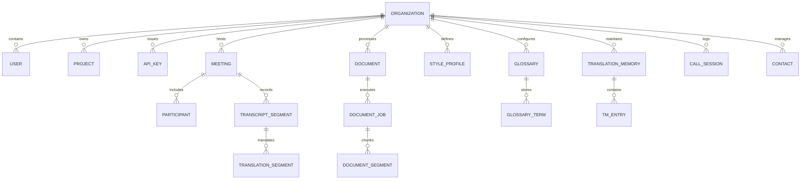

# Phase 1 Application Map: TalkFlow (GlobalTalk AI)

**Date**: 2026-10-28  
**Audit Branch**: `audit-baseline`  
**Target Environments**: Local, Staging (Vercel Serverless + Neon PostgreSQL), Production  

---

## 1. Frontend Architecture (`apps/web`)

The frontend is a single-page application built on React 18, Vite 5, TypeScript (strict mode), and Tailwind CSS. State management is divided between **Zustand** (auth session, meeting participant state, active audio stream) and **TanStack React Query** (server data caching, optimistic updates, and adaptive polling).

### 1.1 Complete Route Catalog
| Route Path | Component / Page | Access Control | Primary Features |
| :--- | :--- | :--- | :--- |
| `/` | `Landing.tsx` / `RootGate` | Public | Hero showcase, live interactive demo, feature breakdown, CTA. |
| `/login` | `Login.tsx` | Public | Email/password login, social OAuth (Google/GitHub/Microsoft), MFA challenge. |
| `/signup` | `Signup.tsx` | Public | Account registration, tenant/organization initialization. |
| `/auth/callback/:provider`| `AuthCallback.tsx` | Public | Handles OAuth redirect flow, token exchange, and cookie initialization. |
| `/join/:roomId` | `JoinCall.tsx` | Public (No login) | Fast-join meeting link for external guests; language selector & LiveKit join. |
| `/meeting/:id` | `MeetingRoom.tsx` | Authenticated/Guest | Full video/audio meeting grid, live bilingual subtitles, screen share, chat. |
| `/meet-companion` | `MeetingCompanion.tsx`| Authenticated/Guest | DeepL Voice-style overlay companion for Google Meet / Zoom / Teams. |
| `/google-meet` | `MeetingCompanion.tsx`| Authenticated/Guest | Alias to meeting companion with direct tab audio bridge instructions. |
| `/dashboard` | `Dashboard.tsx` | Protected | Organization overview, usage counters, quick actions, recent jobs. |
| `/translate` | `Translate.tsx` | Protected / Shell | Dual-pane text translation, auto-detect, formality, glossary toggle, TTS. |
| `/translate/page` | `TranslateWebPage.tsx` | Protected / Shell | Proxy-based multilingual webpage preview and real-time DOM translation. |
| `/write` | `Write.tsx` | Protected / Shell | Writing assistant: grammar fixes, style rephrasing, tone adjustment, diffs. |
| `/documents` | `Documents.tsx` | Protected / Shell | Document queue, drag & drop upload, layout-preserving translation (PDF/DOCX/PPTX/XLSX). |
| `/voice` | `Voice.tsx` | Protected / Shell | Two-way live voice speech-to-speech, microphone capture, instant playback. |
| `/global-call` | `GlobalCall.tsx` | Protected / Shell | WebRTC / PSTN / Twilio international dialer, WhatsApp VoIP mode, agent prompts. |
| `/meetings` | `Meetings.tsx` | Protected / Shell | Meeting scheduler, active room directory, copy invite links, settings. |
| `/notes` | `Notes.tsx` | Protected / Shell | Post-call meeting minutes, bilingual executive summaries, full-text search. |
| `/chat` | `ChatPage.tsx` | Protected / Shell | Real-time multi-user team chat with automatic inline message translation. |
| `/history` | `History.tsx` | Protected / Shell | Translation segment audit log, search by language pair, CSV export, redaction. |
| `/glossaries` | `Glossaries.tsx` | Protected / Shell | Terminology management, case sensitivity flags, CSV/TSV bulk import/export. |
| `/translation-memory` | `TranslationMemory.tsx`| Protected / Shell | Translation memories (TM), fuzzy match confidence, TMX file import. |
| `/style-profiles` | `StyleProfiles.tsx` | Protected / Shell | Custom enterprise style guides, prohibited vocabulary, brand tone rules. |
| `/api` | `ApiKeys.tsx` | Protected / Shell | Developer API keys, role permissions, rate-limit visibility, curl snippets. |
| `/usage` | `Usage.tsx` | Protected / Shell | Consumption metering (characters, audio minutes, token counts) by project. |
| `/billing` | `Billing.tsx` | Protected / Shell | Stripe checkout integration, subscription tier management, invoices. |
| `/settings` | `Settings.tsx` | Protected / Shell | User profile, default speak/hear languages, session management, password change. |
| `/team` | `Team.tsx` | Protected / Shell | Org member directory, role assignment (`owner`, `admin`, `member`, `viewer`). |
| `/admin` | `Admin.tsx` | Platform Admin | System health, tenant management, global model flags, telemetry traces. |
| `/admin/telephony` | `AdminTelephony.tsx` | Platform Admin | Carrier credentials (Twilio, Telnyx, SIP Asterisk trunks), phone number routing. |
| `/agent/calls` | `AgentCalls.tsx` | Protected / Shell | Automated voice campaign dispatch, live agent supervisor seat claiming. |
| `/agents` | `AgentStudio.tsx` | Protected / Shell | Multi-agent orchestration studio (LangGraph & CrewAI ticket router, content crew). |
| `/docs` | `DocsPage.tsx` | Public / Shell | Full interactive API documentation, OpenAPI swagger client, v2/v3 DeepL specs. |

---

## 2. Canonical Backend Architecture (`services/api`)

The primary backend is a FastAPI application configured for high-concurrency async operations. It provides database connection pooling, tenant isolation middleware, rate limiting, and structured OpenAPI schemas.

### 2.1 Backend Routers & API Contracts
| Router File | URL Prefix | Major Endpoints | Key Responsibilities |
| :--- | :--- | :--- | :--- |
| `auth.py` | `/api/v1/auth` | `/signup`, `/login`, `/social-login`, `/refresh`, `/logout`, `/me`, `/password-reset/*` | Multi-factor auth, JWT token pairs (access + refresh), session revocation, GDPR deletion. |
| `translate.py` | `/api/v1` | `/translate`, `/translate/stream`, `/translate/page`, `/detect-language`, `/history` | Core MT pipeline, SSE streaming translation, HTML page fetch & DOM translation. |
| `write.py` | `/api/v1` | `/write`, `/dictionary` | AI rephrasing, grammar correction, vocabulary dictionary lookup, granular text diffing. |
| `documents.py` | `/api/v1/documents`| `POST /`, `GET /`, `GET /{id}/status`, `GET /{id}/result`, `POST /{id}/retry` | Multipart upload, DB-backed storage, chunked batch translation, layout reconstruction. |
| `meetings.py` | `/api/v1/meetings` | `POST /`, `GET /`, `GET /{id}/token`, `POST /{id}/preferences`, `GET /{id}/summary` | Meeting CRUD, LiveKit participant JWT issuance, preferences, AI executive minutes. |
| `google_meet.py` | `/api/v1/google-meet` | `POST /connect`, `POST /disconnect`, `GET /status`, `POST /subtitles` | Google Meet, Teams, and Zoom live audio bridge, dual-channel caption streaming, and meeting companion sync. |
| `telephony.py` | `/api/v1/telephony`| `/calls`, `/calls/dial`, `/calls/bridge`, `/phone-numbers`, `/webhooks/*`, `/agents/*` | Asterisk ARI / Twilio integration, call bridging, IVR sentence chunking, agent prompts. |
| `customization.py`| `/api/v1` | `/glossaries/*`, `/translation-memories/*`, `/style-profiles/*` | Term replacement rules, bilingual dictionary pairs, style guides, TMX exports. |
| `contacts.py` | `/api/v1/contacts` | `POST /`, `GET /`, `POST /{id}/consent`, `POST /{id}/call`, `POST /{id}/jobs` | CRM contact management, calling campaigns, TCPA consent logging, document attachments. |
| `notes.py` | `/api/v1/notes` | `GET /`, `POST /`, `GET /{id}`, `GET /search`, `GET /export` | Meeting transcripts, searchable bilingual notes, Markdown/PDF export. |
| `platform.py` | `/api/v1` | `/api-keys/*`, `/usage`, `/billing/*`, `/webhooks/*`, `/audit-logs` | Tenant API key management, Stripe webhooks, audit trail, usage records. |
| `v2_v3.py` | `/v2`, `/v3` | `/v2/translate`, `/v2/write/*`, `/v2/document/*`, `/v2/glossaries/*`, `/v3/*` | Drop-in DeepL API parity (v2 & v3 specifications, JSON & form-urlencoded). |
| `agent_studio.py` | `/api/v1/agents` | `/status`, `/triage`, `/content-pipeline`, `/research-crew` | LangGraph support triage state router, CrewAI multi-agent research crews. |
| `health.py` | `/` & `/api/v1` | `/health`, `/healthz`, `/ready`, `/readyz`, `/metrics` | Liveness & readiness probes, dependency health checks, Prometheus metrics exporter. |

---

## 3. Data Tier & Relational Models (`services/api/app/db/`)

The application defines **50 relational models** in `services/api/app/db/models.py`, all inheriting from `Base`, `UUIDPkMixin`, and `TimestampMixin` with tenant isolation enforced via `org_id` / `tenant_id`.

### 3.1 Primary Table Classifications
1. **Control Plane & Tenancy**: `users`, `user_identities`, `organizations`, `organization_members`, `projects`, `sessions`, `refresh_tokens`, `api_keys`.
2. **Translation Customization**: `glossaries`, `glossary_terms`, `style_profiles`, `translation_memories`, `translation_memory_entries`, `translation_notes`.
3. **Meetings & Realtime Media**: `meetings`, `participants`, `participant_preferences`, `audio_sessions`, `transcript_segments`, `translation_segments`, `chat_messages`.
4. **Document Processing**: `documents`, `document_jobs`, `document_segments`, `stored_objects`.
5. **Telephony & Agent Dispatch**: `phone_numbers`, `call_sessions`, `call_events`, `agent_prompts`, `prompt_versions`, `contacts`, `contact_consents`, `campaigns`, `call_jobs`, `agent_escalations`.
6. **Metering, Billing & Audit**: `usage_records`, `subscriptions`, `billing_events`, `audit_logs`, `integrations`, `webhook_endpoints`, `webhook_deliveries`.

---

## 4. AI & Media Pipeline Architecture (`ai/` & `services/api/app/realtime`)

The AI subsystem abstracts language and audio intelligence into unified provider interfaces with automatic failover cascades.

```mermaid
flowchart LR
    A["Audio Ingestion (Mic / Tab)"] --> B["VAD (Silero / WebRTC)"]
    B --> C["STT Engine (Whisper / Azure)"]
    C --> D["Context & Terminology Preprocessor"]
    D --> E["MT Engine (Argos / NLLB / GPT-4o / DeepL Parity)"]
    E --> F["Style & Glossary Postprocessor"]
    F --> G["TTS Engine (Piper / Azure / ElevenLabs)"]
    G --> H["Audio Output & Bilingual Subtitles (LiveKit / WS)"]
```

### 4.1 Provider Fallback Cascades
- **Speech-to-Text (STT)**: Faster-Whisper (local CPU/GPU) $\rightarrow$ Azure Speech STT $\rightarrow$ Deepgram Nova-2.
- **Machine Translation (MT)**: Local Argos Translate / NLLB-200 $\rightarrow$ OpenAI GPT-4o-mini $\rightarrow$ Azure Translator $\rightarrow$ Groq Llama-3.
- **Text-to-Speech (TTS)**: Piper TTS (ultra-low latency <150ms) $\rightarrow$ Azure Speech Neural $\rightarrow$ ElevenLabs.
- **Writing Assistant**: Rule-based grammar engine $\rightarrow$ Local LLM / OpenAI fine-tuned style rewriter.

---

## 5. Deployment Architecture

- **Vercel Serverless Multi-Service**: Configured via `vercel.json` with path rewrites routing `/api/*`, `/v2/*`, `/v3/*`, `/ws/*` to FastAPI (`services/api`), and `/*` to Vite React SPA (`apps/web`).
- **Neon Cloud PostgreSQL**: High-performance pooled connection via `asyncpg` with SSL and automatic database migrations via Alembic.
- **Docker Production Engine**: `infrastructure/docker/Dockerfile.api` and `Dockerfile.web` for containerized high-scale deployments.

