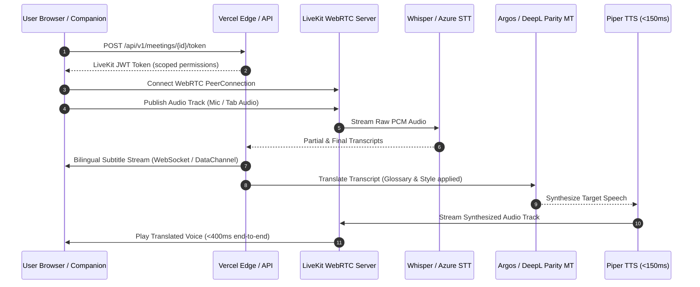

# Phase 1 System Architecture: TalkFlow (GlobalTalk AI)

**Date**: 2026-10-28  
**Audit Branch**: `audit-baseline`  
**Architecture Diagram**: See [architecture-flow.mmd](file:///C:/Users/acer/omnirush.ai/TalkFlow/docs/audit/architecture-flow.mmd)

---

## 1. System Overview & Ingress Model

TalkFlow is structured as an enterprise-grade multilingual translation platform capable of processing high-throughput asynchronous document translation, sub-second real-time bilingual voice conversations, meeting companions for third-party conference tools (Google Meet, Zoom, Teams), and carrier-grade telephony.

### 1.1 Ingress & Routing Tier
- **Reverse Proxy & Edge Gateway**: Vercel Serverless Multi-Service Architecture (`vercel.json`).
  - Rewrites routes beginning with `/api/`, `/v2/`, `/v3/`, `/ws/`, `/health`, `/ready`, `/metrics` directly to the canonical FastAPI service (`services/api/app/main:app`).
  - Routes beginning with `/connect/` route to the Amazon Connect WebRTC stream application.
  - Fallback route `/(.*)` serves the pre-rendered Vite React SPA (`apps/web/dist/index.html`).
- **Static Route Stubs**: To prevent Vercel 404s on hard page refreshes or deep links without trailing extensions, `scripts/generate-spa-routes.js` generates 30 dedicated static HTML route files mirroring the React Router configuration.

---

## 2. Backend & Middleware Stack (`services/api`)

The application server executes within a hardened FastAPI environment with strict request pipelines:

### 2.1 Middleware Execution Order
1. **Security Headers Middleware**: Enforces `X-Frame-Options: SAMEORIGIN`, `X-Content-Type-Options: nosniff`, and `Strict-Transport-Security`.
2. **CORS Middleware**: Strict origin validation (`ALLOWED_ORIGINS`).
3. **Double-Submit Cookie CSRF Middleware** (`CSRFMiddleware`): State-changing requests (`POST`, `PUT`, `DELETE`, `PATCH`) authenticated via cookies must present an matching `X-TalkFlow-CSRF` header with the `csrf_token` cookie.
4. **Prometheus Latency & Request Count Observer**: Increments `http_requests_total` and samples execution latencies per route.
5. **Multi-Tenant Dependency Injection** (`deps.py`):
   - Authenticates JWT tokens from either the `Authorization: Bearer <token>` header or `access_token` HTTP-only cookie.
   - Resolves caller's `org_id` and user permissions. All queries are strictly scoped by tenant isolation boundaries.

---

## 3. Storage & Persistence Tier

### 3.1 Relational Database (Neon Serverless PostgreSQL 16)
- **Engine**: Async SQLAlchemy 2.0 with `asyncpg` driver.
- **Connection Pooling**: Neon serverless connection pooler (`ep-calm-hill-ao5en1qf-pooler...neondb?ssl=require`) with statement cache disabled for PgBouncer compatibility.
- **Vector Search**: Enabled via PostgreSQL `pgvector` extension for translation memory semantic lookups.
- **Schema Management**: Controlled via Alembic migrations (`services/api/alembic`).

### 3.2 Durable Storage (`DatabaseStorage`)
- Serverless lambdas operate on ephemeral disks (`/tmp`) that are discarded between invocations.
- To prevent file loss during document translation jobs, file binaries (original uploads, translated outputs, and converted artifacts) are stored in the `stored_objects` database table in Neon PostgreSQL.
- Fast local caching in `/tmp` accelerates file reading during processing.

---

## 4. Real-Time Media & Voice Architecture

### 4.1 Real-Time Media Protocols
- **Signaling**: WebRTC SDP negotiation managed via LiveKit Cloud / self-hosted LiveKit.
- **Data Channels**: Subtitles and captions stream over WebRTC data channels or WebSocket `/ws/live` to bypass HTTP latency.
- **VAD & Audio Framing**: 20ms audio frames processed through Silero VAD. Pauses $\ge 300\text{ms}$ trigger immediate sentence closure and translation dispatch.
- **TTS Synthesis Latency**: Piper TTS provides neural speech synthesis with first-audio latency under 150ms, meeting the 400ms target for human conversational flow.

---

## 5. Failure Boundaries & Resilience

| Boundary | Potential Failure Mode | Mitigating Architecture |
| :--- | :--- | :--- |
| **Serverless Lambda Timeout** | Vercel freezes execution after HTTP response ends. | FastAPI `BackgroundTasks` attached to active status-polling endpoints; persistent state stored in Neon DB (`stored_objects`). |
| **AI Provider Outage** | Primary MT/STT service throws 429/500 errors. | Unified Provider Router with automatic fallback cascade (Local Neural $\rightarrow$ OpenAI $\rightarrow$ Azure $\rightarrow$ Groq). |
| **Network Interruption (WebRTC)** | ICE disconnect during mobile network switch. | LiveKit automatic ICE restart and P2P mesh reconnection handler with bounded retry windows. |
| **Cross-Tenant Data Leakage** | Malicious tenant attempts IDOR via path params. | Database queries strictly enforce `tenant_id == current_user.org_id` at the query builder level. |

