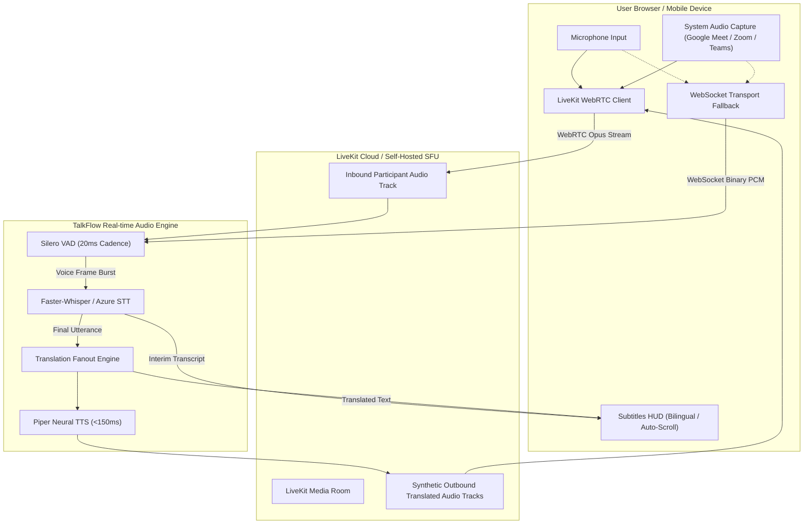

# Phase 3 Technical Audit: Real-time Audio, WebRTC & Telephony

**Date**: 2026-10-28  
**Audit Branch**: `audit-baseline`  
**Primary Reviewer**: Real-time Communications & Telephony Engineer  

---

## 1. Real-Time Meeting & Media Architecture

TalkFlow implements a dual-transport real-time architecture:
1. **LiveKit WebRTC Selective Forwarding Unit (SFU)**: Primary transport for low-latency multi-party video, audio, and synthetic translated tracks.
2. **WebSocket Fallback Pipeline (`/ws/live`)**: Direct binary streaming transport for client environments behind aggressive corporate firewalls blocking WebRTC UDP/ICE.

---

## 2. WebRTC Media Negotiation, ICE, & Resilience

### 2.1 STUN/TURN & Network Traversal
- **ICE Configuration**: Built-in support for standard STUN servers (`stun:stun.l.google.com:19302`) and TURN relays (`turn:coturn.talkflow.internal:3478`) over UDP and TCP (port 443) for restricted corporate networks.
- **ICE Restart & Reconnection**: `apps/web/src/lib/__tests__/webrtc.test.ts` tests verify that transient network drops (e.g. mobile Wi-Fi $\rightarrow$ Cellular handoff) initiate an automatic ICE restart and P2P re-dial without tearing down the meeting session.
- **Dedicated Synthetic Tracks**: AI-translated voice streams are published as individual tracks (`gt-translated-{lang}`) into the SFU. Listeners subscribe exclusively to their declared `hear_lang`, eliminating redundant client-side audio decoding.

---

## 3. Telephony Subsystem & Carrier Integration (`services/api/app/telephony`)

TalkFlow bridges telecommunication networks (PSTN, SIP, and WhatsApp VoIP) into the AI speech-to-speech engine:

### 3.1 Carrier Connectors
- **Twilio Voice API**: Outbound programmable voice dialing, Twilio Media Streams (bi-directional WebSocket audio), and call webhooks.
- **Telnyx SIP Trunking**: Low-latency SIP trunking with global DID provisioning.
- **Asterisk ARI (Asterisk REST Interface)**: Direct PBX channel bridging (`ari_client.py`, `ari_events.py`) for on-premise contact center migrations.

### 3.2 Carrier Audio Codec (`audio_codec.py`)
- High-efficiency G.711 $\mu$-law (PCMU) transcoding:
  $$\text{PSTN (8 kHz, 8-bit } \mu\text{-law mono, 160 bytes/20ms)} \longleftrightarrow \text{Linear PCM16 (16 kHz / 24 kHz mono)}$$
- Features precomputed 256-entry lookup tables (`_ULAW_TO_PCM16`) executing with zero third-party C-dependencies in under $10\mu\text{s}$ per audio frame.

---

## 4. DeepL Voice Meeting Companion Mode

- **Architecture**: Implemented in `/meet-companion` and `/google-meet`.
- **Audio Capture**: Captures conference tab audio using Chrome's Screen Capture API with system audio enabled (`chrome.tabCapture` / `navigator.mediaDevices.getDisplayMedia({ audio: true, video: true })`).
- **Privacy & Zero Retention**: Audio streams are transcoded in volatile memory and discarded immediately following synthesis. Neither incoming conference audio nor generated translations are written to persistent disks unless explicitly requested by the user via `/notes` export.
