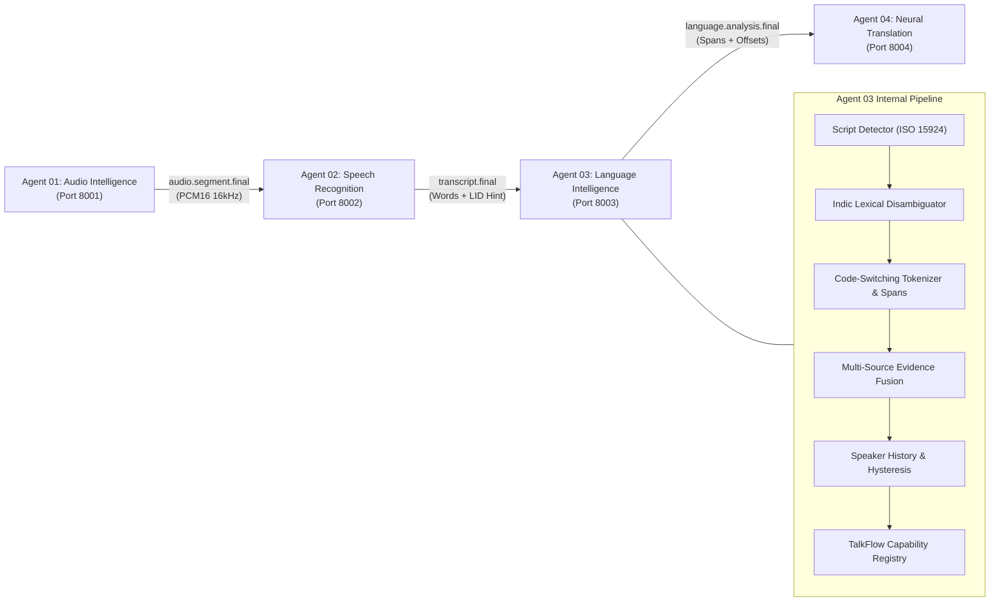

# Architecture: TalkFlow Language Intelligence Agent (Agent 03)

## 1. System Overview

The **Language Intelligence Agent (Agent 03)** is a production-grade Python microservice in the TalkFlow / GlobalTalk AI multi-agent real-time speech translation architecture. It receives timestamped transcripts from **Agent 02 (Speech Recognition Agent)**, analyzes linguistic and acoustic signals, detects sub-sentence code-switching (e.g., Hinglish), disambiguates Indian languages (e.g., Marathi vs. Hindi in Devanagari script), and routes validated language metadata to **Agent 04 (Neural Translation Agent)**.

## 2. Multi-Signal Evidence Fusion

Language classification does not rely on a single model. The agent calculates a calibrated composite score across five distinct signal vectors:

1. **Statistical Text LID (40% Weight)**: fastText `lid.176` utilizing direct C++ extension calls for microsecond inference and NumPy 2.x compatibility.
2. **STT Acoustic Hint (25% Weight)**: Whisper Language Identification probabilities from Agent 02.
3. **Unicode Script Distribution (20% Weight)**: Proportional analysis of Unicode blocks (`Deva`, `Latn`, `Arab`, `Beng`, `Taml`, `Telu`, `Gujr`, etc.).
4. **Speaker Context Hysteresis (15% Weight)**: Sliding window (10 utterances) of speaker history to prevent flip-flopping on isolated loanwords.
5. **Sub-Sentence Span Tokenization**: Heuristic vocabulary matching for Romanized Indian languages (Hinglish).

## 3. Devanagari Hindi vs. Marathi Disambiguation

Hindi and Marathi both share Devanagari script. The agent employs verified lexical regexes to prevent misclassification:
- **Marathi Lexical Markers**: `आहे`, `आहेत`, `तुम्ही`, `काय`, `आणि`, `नाही`, `कसे`, `खूप`, `झाले`, `होते`.
- **Hindi Lexical Markers**: `है`, `हैं`, `आप`, `क्या`, `और`, `नहीं`, `कैसे`, `बहुत`, `था`, `रहा`.

## 4. Fail-Closed Honest Degradation

If transcript text is under 3 characters (e.g., "Hi", "ok", numbers) or composite confidence falls below 0.45, the agent reports honest uncertainty with `primary_language: "und"` and explicit diagnostic reason codes (`text_too_short`, `low_confidence_threshold`). It never hallucinates language tags or defaults to English.

