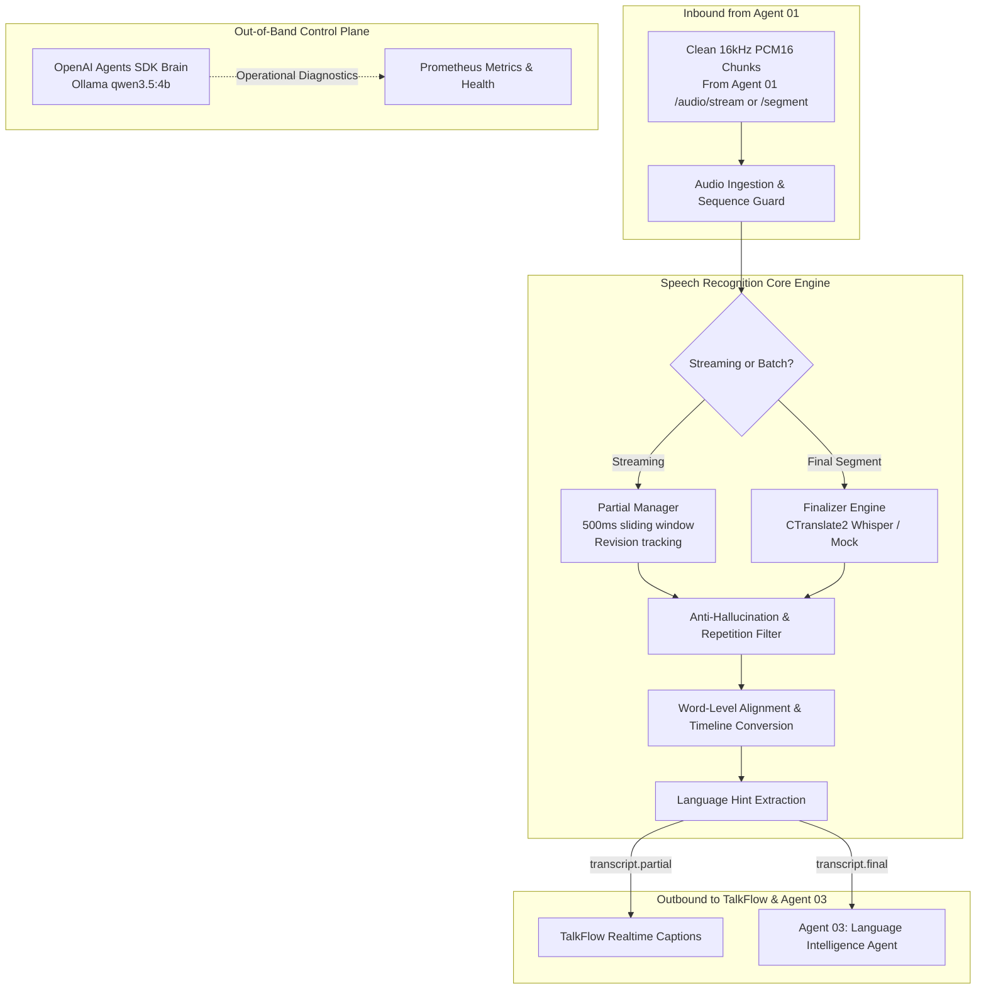

# TalkFlow Speech Recognition Agent (Agent 02) — Architecture Document

## 1. System Overview

Agent 02 is responsible for transcribing clean, timestamped audio segments produced by Agent 01 (Audio Intelligence Agent) and emitting structured partial and final transcript events for Agent 03 (Language Intelligence Agent).

### Key Architectural Boundaries:
1. **Deterministic Speech-to-Text Pipeline**: The speech recognition pipeline (`faster-whisper` + CTranslate2) processes audio deterministically without any LLM in the audio inference path.
2. **Out-of-Band Operational Intelligence**: The OpenAI Agents SDK coupled with local Ollama (`qwen3.5:4b`) runs as an operational control-plane assistant to diagnose service health, analyze latency metrics, and recommend hardware-tuned model configurations.
3. **Decoupled Identity Management**: Agent 02 preserves session, speaker, utterance, and segment IDs received from Agent 01 without inventing conflicting global event sequences.

