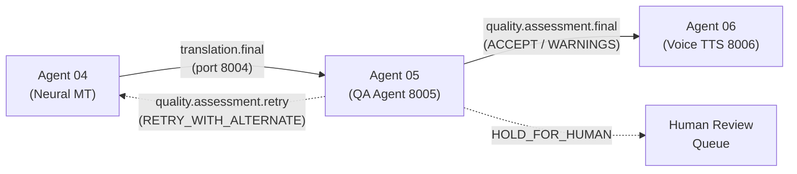

# TalkFlow Agent 05: Translation Quality Agent (QA Agent) Architecture

## 1. System Mission & Scope
The **Translation Quality Agent (Agent 05)** operates directly between **Agent 04 (Neural Translation Agent)** and **Agent 06 (Voice Generation Agent / TTS)** in the TalkFlow real-time speech translation architecture.

Its core mission is to **independently evaluate** translation candidates generated by Agent 04, detect factual or numeric errors, measure meaning preservation, verify terminology compliance, and enforce hard safety gates before speech synthesis occurs.

## 2. Layered Evaluation Pipeline
Agent 05 executes a tiered, ultra-low-latency pipeline designed for live conversational workflows:

1. **Idempotency & Deduplication Layer (<1 ms)**
   - Computes deterministic SHA-256 candidate hashes: `sha256(source_text + "||" + target_text + "||" + src_lang + "||" + tgt_lang)`.
   - Prevents duplicate evaluations of identical segments across multi-participant fanouts.

2. **Deterministic Data Integrity Layer (<10 ms)**
   - **Number Integrity Check**: Canonicalizes Devanagari/Bengali numerals and Indian vs Western grouping (`12,50,000` $\to$ `1250000`).
   - **Currency Check**: Prevents corruptions between ₹, $, €, £, ¥, and ISO codes.
   - **Dates & Times Check**: Preserves numeric dates (e.g. `15/08/1947`) and detects temporal anchor flips (e.g. today vs tomorrow, next month vs next year).
   - **URLs & Entities Check**: Ensures technical identifiers, ticket numbers, and web domains are preserved verbatim.
   - **Protected Spans Check**: Flags leaked internal replacement tokens (e.g., `__TF_IMM_0__`).
   - **Negation & Directionality Check**: Catches critical polarity flips (affirmative $\leftrightarrow$ negative) across English and Indic scripts.
   - **Target Script & Language Check**: Validates script consistency (Devanagari for `hi`/`mr`, Bengali for `bn`, Kanji/Kana for `ja`, Latin for `en`).
   - **Glossary Compliance Check**: Enforces mandatory tenant glossary substitutions.
   - **Length & Repetition Check**: Flags abnormal expansion/compression ratios and MT loop hallucinations.

3. **Semantic Quality Evaluation Layer (<20 ms)**
   - **Semantic Multilingual Evaluator**: Measures cross-lingual token overlap, lexical density, and syntactic discourse balance without requiring gold references.
   - **SacreBLEU / chrF++ Evaluator**: Reference-based evaluation for benchmarking and regression analysis.
   - **COMET Adapter**: Extensible interface for heavy reference-free neural QE models.

4. **Multi-Dimensional Scoring & Hard Safety Gates**
   - Composite scoring across Semantic Accuracy (0.35), Data Integrity (0.25), Completeness (0.15), Terminology (0.15), and Fluency (0.10).
   - **Hard Safety Gate Ceiling**: When a critical error (number corruption, currency mutation, wrong script, or negation flip) is present, the composite score is strictly **capped at $\le 0.35$**, preventing high fluency from ever masking factual damage.

5. **Decision Engine & Out-of-Band Operations Brain**
   - Deterministic resolution to `ACCEPT`, `ACCEPT_WITH_WARNINGS`, `RETRY_WITH_ALTERNATE_PROVIDER`, `HOLD_FOR_HUMAN`, or `REJECT`.
   - Out-of-band operational reasoning brain powered by the OpenAI Agents SDK and local Ollama (`qwen3.5:4b`) for drift analysis, diagnostic telemetry, and provider error reporting without blocking live audio streams.

