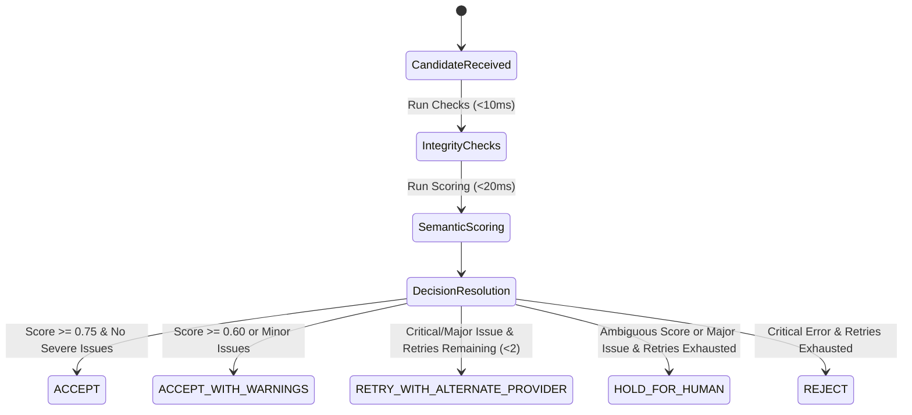

# TalkFlow Agent 05 Decision Engine Policy

## 1. Actionable Decision States
The Decision Engine maps evaluation findings directly to one of five mutually exclusive operational states:

### 1. ACCEPT
- **Criteria**: Composite score $\ge 0.75$, no critical errors, no major errors.
- **Action**: Published immediately to Agent 06 (TTS) via `quality.assessment.final`.

### 2. ACCEPT_WITH_WARNINGS
- **Criteria**: Composite score $\ge 0.60$, minor style/formatting issues, no critical errors.
- **Action**: Dispatched to Agent 06 with warning flags logged in telemetry.

### 3. RETRY_WITH_ALTERNATE_PROVIDER
- **Criteria**: Critical integrity failure or major terminology failure detected, and segment retry count $< \text{retry\_budget}$ (default: 2).
- **Action**: Dispatched to Agent 04 via `quality.assessment.retry` with explicit `recommended_provider` hint (e.g. Marian $\leftrightarrow$ Argos $\leftrightarrow$ Neural Online).

### 4. HOLD_FOR_HUMAN
- **Criteria**: Retries exhausted on major terminology violation, or composite score is in ambiguous borderline band without critical failure.
- **Action**: Enqueued in thread-safe `HumanReviewQueue` accessible via `/api/v1/quality/review-queue`.

### 5. REJECT
- **Criteria**: Critical integrity failure persists after retry budget exhausted, or catastrophic hallucination/untranslated repetition.
- **Action**: Discarded with telemetry warning; suppressed from reaching speech synthesis (fail-closed guarantee).

